# All and One — RED · BLUE · YELLOW Ant-Team

All and One - RED-BLUE-Yellow-Ant-Team

**Orchestriertes Security-Framework mit drei Teams:** Bug Bounty & Pentest (Red), Schutz & Hardening (Blue), Reverse Engineering (Yellow). Ein Prozess, ein Port, eine Adresse.

Orchestrierte Ameisenfarmen — die vom Bug Bounty und Pentest über Reverse Engineering bis zum Schutz und Hardening helfen.

Jedes echte Ergebnis – Ziele, Läufe, Befunde, Logs – mehrt den Reichtum der Ameisenstadt, und dieses Wachstum kennt keine Endstufe: Wissen selbst ist ihr Wohlstand. Je mehr Wissen und Macht eine Königin sammelt, desto besser weiß sie ihr Volk zu führen, einzusetzen und zu schützen. Die Ausbaustufe der Stadt wird bereits aus den echten Zählern berechnet und angezeigt (ab 1 Hütten, 10 Brunnen, 50 Steinhäuser, 200 Türme, 1000 moderne Gebäude); die zugehörigen 3D-Gebäude sind in Arbeit.

> Unbefugtes Ausspähen, Abfangen oder Vorbereiten von Angriffen auf Daten ist strafbar (§ 202a–c StGB; im US-Kontext der CFAA). Aktive Arbeit läuft nur mit bestätigtem Human Oversight und einem konkreten Ziel im Scope. Der Hinweis ersetzt kein Oversight.

## Schnellstart

Dieselben Schritte wie im englischen [Quick start](README.md#quick-start). Die Unit `deploy/antbb.service` läuft als `User=antbb` / `Group=antbb` mit `WorkingDirectory=/opt/antbb` und liest `/opt/antbb/antbb.env`. `useradd --create-home` legt `/opt/antbb` an, deshalb klont man daneben und kopiert mit dem `rsync` aus [DEPLOY.md](DEPLOY.md).

```bash
sudo useradd --system --create-home --home-dir /opt/antbb --shell /usr/sbin/nologin antbb
git clone https://github.com/krockodog/antbb-framework.git
sudo rsync -a --exclude .git --exclude antbb.env --exclude data ./antbb-framework/ /opt/antbb/
sudo python3 -m venv /opt/antbb/.venv
sudo /opt/antbb/.venv/bin/pip install -r /opt/antbb/requirements.txt
sudo cp /opt/antbb/antbb.env.example /opt/antbb/antbb.env
sudo chmod 600 /opt/antbb/antbb.env
cd /opt/antbb && sudo .venv/bin/python -m antbb.webauth hash-password
```

Die ausgegebene Zeile als root in `/opt/antbb/antbb.env` schreiben: `ANTBB_ADMIN_PASSWORD_HASH=...` (kein Passwort ins Kommando). Danach Besitz abgeben, Dienst starten, http://127.0.0.1:1001/login öffnen:

```bash
sudo chown -R antbb:antbb /opt/antbb
sudo cp /opt/antbb/deploy/antbb.service /etc/systemd/system/antbb.service
sudo systemctl daemon-reload
sudo systemctl enable --now antbb
```

Direktstart, ebenfalls als `antbb` (`python -m api` liest `antbb.env` nicht selbst):

```bash
sudo -u antbb bash -c 'cd /opt/antbb && set -a && . ./antbb.env && set +a && exec .venv/bin/python -m api --host 127.0.0.1 --port 1001'
```

Ohne `ANTBB_ADMIN_PASSWORD_HASH` (oder `ANTBB_ADMIN_PASSWORD`) startet nichts. Nicht als root starten. Bind bleibt `127.0.0.1`, außer `ANTBB_EXPOSE=1` ist absichtlich gesetzt. Fernzugriff über einen SSH-Tunnel (`ssh -L 1001:127.0.0.1:1001 <user>@<host>`), nicht über einen offenen Port. `./run.sh` ist der andere Starter und nutzt standardmäßig Port 8000.

---

## Inhalt

1. [Schnellstart](#schnellstart)
2. [Überblick](#überblick)
3. [Red Queen – Offensive Sicherheit](#red-queen--offensive-sicherheit)
4. [Blue Queen – Schutz & Hardening](#blue-queen--schutz--hardening)
5. [Yellow Queen – Reverse Engineering](#yellow-queen--reverse-engineering)
6. [Gemeinsame Bereiche: Hub, Neuronales Gehirn, Historie, Reports](#gemeinsame-bereiche)
7. [Architektur](#architektur) · [Installation](#installation) · [Betrieb](#betrieb) · [Sicherheitsmodell](#leitplanken--sicherheitsmodell) · [Roadmap](#roadmap)

---

## Überblick

| Team | Rolle | Kern |
|---|---|---|
| **Red Queen** | Red-Teaming | Bug Bounty & Pentest im engen Scope, 5-Phasen-Pipeline, Findings mit Proof-Gate, Fix-Brücke zu Blue, Funk-Labor (WLAN/BT/IoT) mit Späher |
| **Blue Queen** | Blue Safety-Teaming | Schutz & Hardening, 6-Phasen-Pipeline (Assess → Verify), Greenbone-Anbindung, Remediation mit Vorher/Nachher-Evidence |
| **Yellow Queen** | Yellow Reverse-Teaming | Reverse Engineering von Samples (EXE/DLL/APK/ELF/HEX), 6-stufige RE-Pipeline mit begründeten Schritten |

Zusammenspiel: **Red** belegt den Angriffspfad → **Yellow** verifiziert offline → **Blue** behebt, testet erneut und dokumentiert.

| Rote Königin | Blaue Königin | Gelbe Königin |
|---|---|---|
| 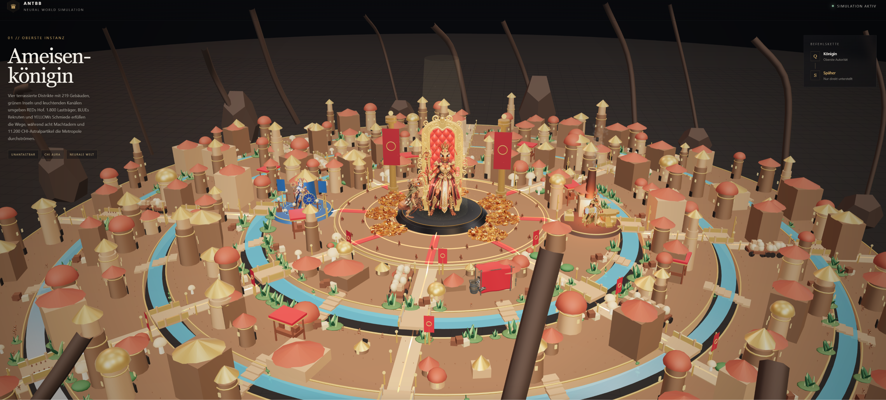 |  |  |

*Echte Renders der 3D-Modelle aus `antbb/web/static/brain/queen-viewer.js` (WebGL).*

---

Gemeinsame Leitplanken aller Teams (Scope default-deny, Human Oversight, Proof-Gate, Honest-empty): siehe [Sicherheitsmodell](#leitplanken--sicherheitsmodell).

---

## Red Queen – Offensive Sicherheit

Route `/red`. 18 Soldaten mit Playbooks, Tools und abhakbaren Aufgaben.

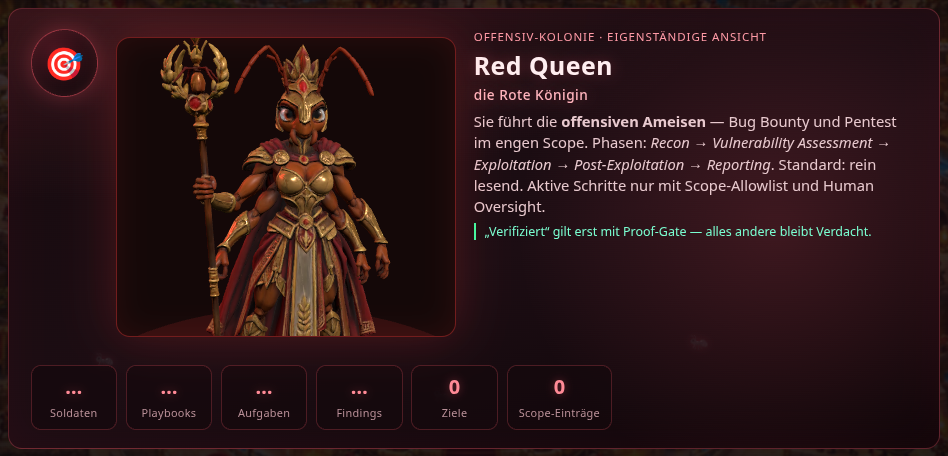

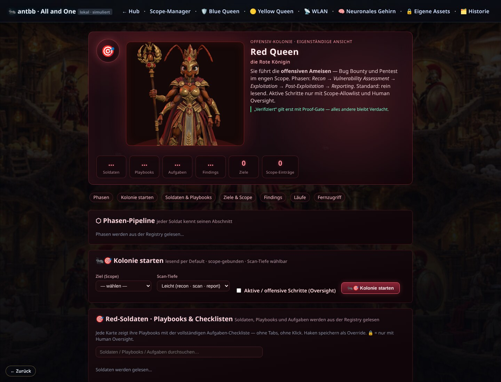

**Funktionen**
- **Statistiken:** Soldaten, Playbooks, Aufgaben, Findings, Ziele, Scope-Einträge – echte Werte aus der Registry.
- **Phasen-Pipeline:** Recon → Vulnerability Assessment → Exploitation → Post-Exploitation → Reporting (defensiv/offensiv gekennzeichnet).
- **Red-Team-Menü** (nach Zielauswahl): Recon & OSINT · Schwachstellen-Scan · Aktive Verifikation (Oversight) · PoC aus Evidence (Oversight) · LLM-Security · Reporting. Jeder Klick legt einen echten Lauf an.
- **Ziele & Scope-Manager:** Ziele anlegen (Name, Beschreibung, `mode_policy`), Scope-Einträge, Oversight-Status, Archivieren (`/trash`), Undo der letzten Scope-/Target-Änderung (setzt nie Oversight).
- **Findings:** über alle Ziele, nach Schwere sortiert; „In Blau reparieren“ erzeugt einen echten Remediate-Job in `/blue`.
- **Fernzugriff:** lokal / Tailscale / Cloudflare-Tunnel; Start nur mit Oversight-Bestätigung.

**Orchestrierung eines Laufs** (`antbb/web/app.py`, `antbb/service.py`)
1. Ziel anlegen und Scope-Einträge pflegen (`/target/add`, `/target/{id}`).
2. Oversight für das Ziel bestätigen (`POST /target/{id}/oversight`).
3. Kolonie starten: Scan-Tiefe *Leicht* (recon · scan · report) oder *Intensiv* (alle Phasen); aktive bzw. offensive Schritte nur mit zusätzlichem Oversight-Häkchen.
4. Der Lauf startet als Hintergrund-Thread (`_start_scan_async` → `svc.run_scan`); es läuft immer nur ein Scan gleichzeitig (sonst HTTP 409). Fehlt Oversight, endet der Lauf mit Status `error`.
5. Ereignisse erscheinen im Live-Feed; nach Abschluss werden Schwere-Verteilung, Findings und der Run-Eintrag in der Historie gespeichert.

### Funk-Labor (`/wlan`)
WLAN-Scope (Allowlist), Coverage & Scan (passiv und Königin-Voll-Scan mit rein defensiven Checks), Heatmap, Offensiv/Airgorah sowie Bluetooth/BLE- und IoT-Lab-Karten.

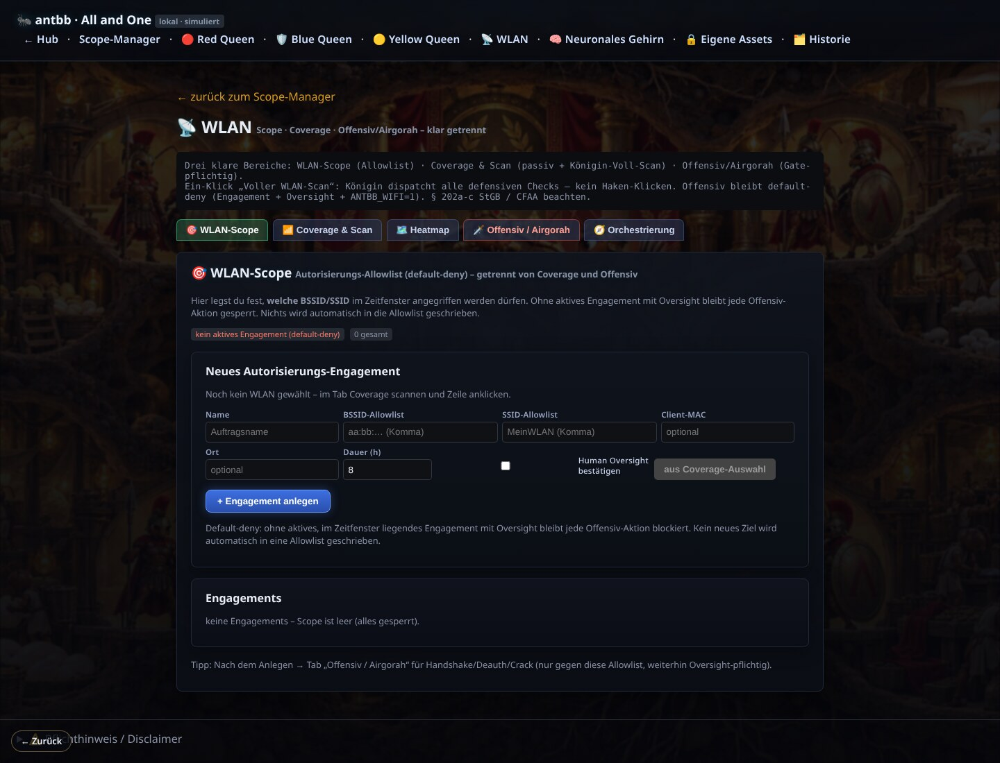

**Späher (Scout):** Im Tab *Coverage & Scan* zeigt `/wlan` den WLAN-Späher als 3D-Modell (`queen-viewer.js`, Modell `archer.glb`) neben dem Königin-Voll-Scan und den erkannten Geräten. Ohne WebGL erscheint statt des Modells nur der Text-Hinweis „WebGL nicht verfügbar“ (Text-Fallback).

| Späher |
|---|
|  |

*Echter Render des Späher-Modells (`archer.glb`) aus `queen-viewer.js`, im selben Stil wie die Königinnen.*

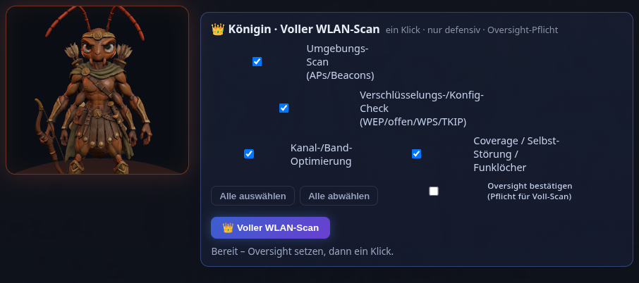

Erkannte Geräte im Funk-Labor:

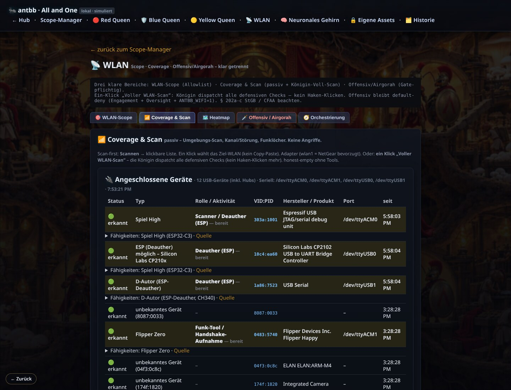

| Tab | Bild |
|---|---|
| Coverage & Scan | 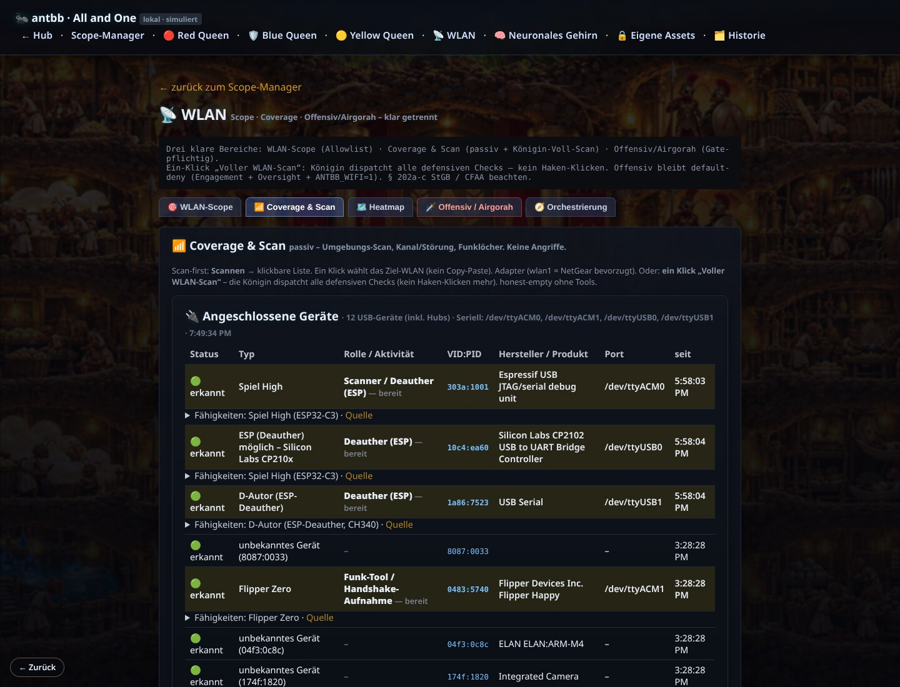 |
| Heatmap | 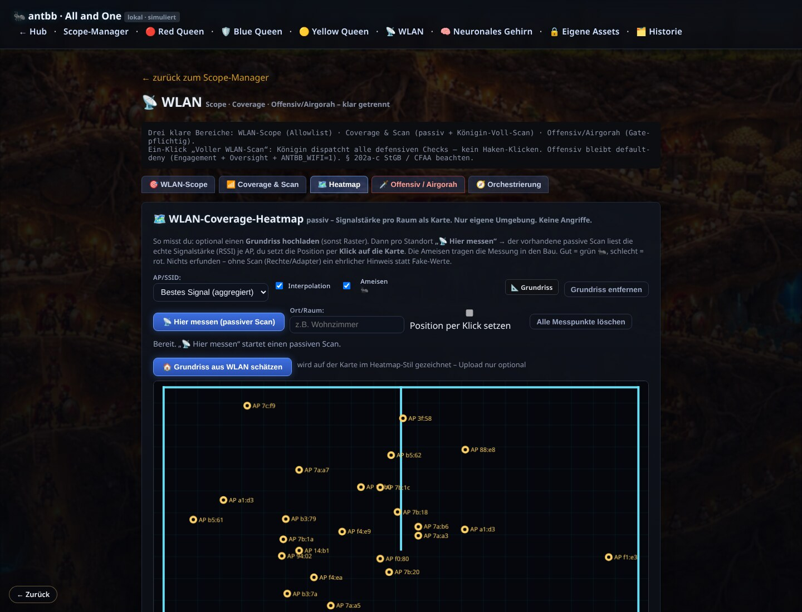 |
| Offensiv/Airgorah | 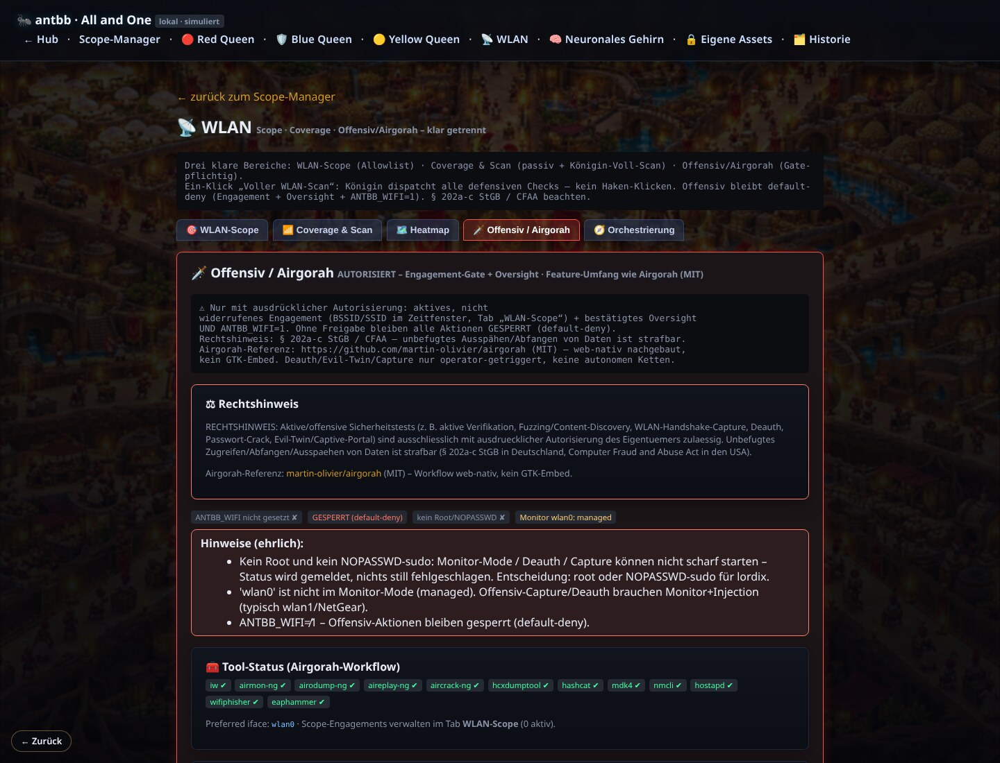 |

- **Gates im Funk-Labor:** Passive Coverage-Scans brauchen kein Engagement; die Client-Abfrage verlangt eine Oversight-Bestätigung; offensive Aktionen brauchen Engagement-Gate, Oversight und `ANTBB_WIFI=1`.
- **Offensiv/Airgorah:** an [Airgorah](https://github.com/martin-olivier/airgorah) (MIT) angelehnte, web-native Audit-Schicht (`antbb/wlan_airgorah.py`): Interface/Monitor-Mode-Status, AP-/Client-Liste, Handshake/PMKID, gezielter Deauth, Offline-Crack. Kein Airgorah-Code eingebettet. Scharfe Aktionen nur über `wlan_offensive` mit **Engagement-Gate + Oversight + `ANTBB_WIFI=1`**; keine autonomen Ketten.
- **Bluetooth/BLE** (passiv): Inventar, GATT-Lesekarte, Verbindungs-Tracking; Verifikation nur an eigenen Geräten mit Oversight.
- **IoT-Lab** (eigene Geräte): Inventar (FritzBox/mDNS/SSDP), MQTT-Audit, Zigbee/Z-Wave-Karte, Default-Credential-Check; Kette Red → Yellow → Blue.

### Reports (Red, zielbezogen)
- `GET /target/{id}/branded-report` – gebrandeter HTML-Report (Firma, Logo, Farbe, Titel, Kunde als Parameter).
- `GET /target/{id}/report/print` – druckoptimierte Ansicht (Browser: Drucken → Als PDF).
- `GET /target/{id}/report.pdf` – PDF-Download über weasyprint/wkhtmltopdf; ohne Engine ehrlicher HTML-Fallback.
- `GET /report/{id}/view`, `GET /report/{id}/export?format=md|json` – Markdown-Ansicht bzw. Export nach `data/exports/`; Addenda und Revisionen über `/report/{id}/addendum`, `/report/{id}/revisions`.

---

## Blue Queen – Schutz & Hardening

Route `/blue`. 25 Soldaten (Greenbone, Hardening, Watcher, AV/ClamAV, Remediation, Re-Check).

> **Betriebsstand (Bestandsaufnahme 01.11.2026):** Greenbone ist eingebaut, auf dem Referenz-Laptop läuft der Dienst aber nicht (gvmd/Socket und `python-gvm` fehlen) – der Report-Import aus Datei funktioniert. Der ClamAV-Scan ist echt; `freshclam` und `clamd` laufen dort nicht als Dienst. Canary/Fallen sind echt, lauschen aber nur auf Loopback und sind flüchtig.

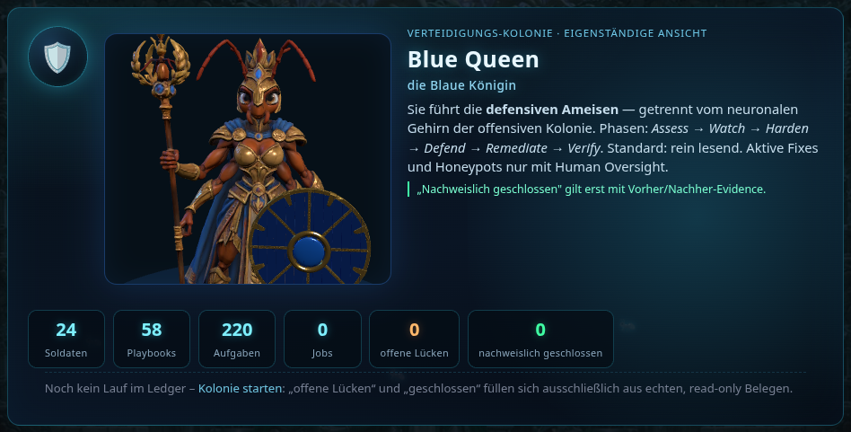

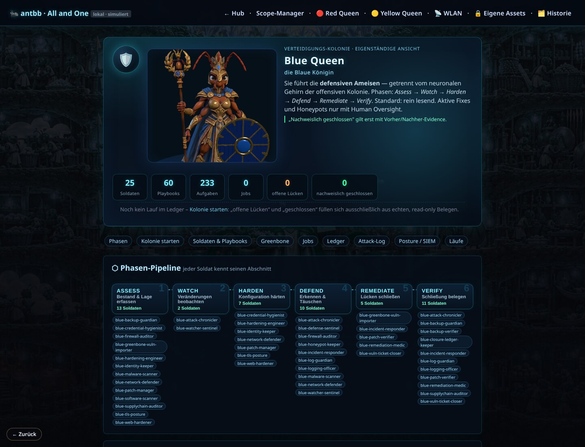

- **Phasen-Pipeline:** Assess → Watch → Harden → Defend → Remediate → Verify.
- **Kolonie starten** (`POST /api/blue/run`): *Leicht* = Assess + Harden, *Intensiv* = alle Phasen; read-only per Default, aktive Fixes (`apply_fixes`) nur mit Oversight (sonst HTTP 403).
- **Greenbone/OpenVAS:** Report-Import (XML/CSV/JSON, rein lesend) und Scoped Scan auf einen In-Scope-Host (Oversight-Pflicht; ohne GVM ehrlicher 503).
- **Jobs:** wiederholbare Checks (Software-Scan, Hardening, Remediation-Verify) mit Intervall und manuellem Auslösen.
- **Posture-Ledger:** Vorher/Nachher über Läufe; „nachweislich geschlossen“ nur mit Re-Check.
- **Attack-Log** (append-only), **Posture/SIEM** (optional Splunk HEC), **Remediation** (Fix-Brücke aus Red; ohne Target-Oversight HTTP 403), **Blue-Läufe**.

---

## Yellow Queen – Reverse Engineering

Route `/yellow`. 9 RE-Soldaten (triage, pe, dotnet, android, elf, hex, carve, dos, dynamic), Ghidra/ghidra-mcp.

> **Betriebsstand:** Die normale Fall-Pipeline ist echt (`file`, `strings`, `readelf`, `rizin`, Live-JSONL). Orchestrate-Schritte lesen den Fallordner `CASES_DIR/<id>` inklusive `evidence/sample.bin` (früher fälschlich `DATA_DIR/cases`). `analyzeHeadless` wird aufgerufen, wenn Ghidra installiert ist; fehlen `capa` oder `floss`, bleibt das Ergebnis ehrlich leer.

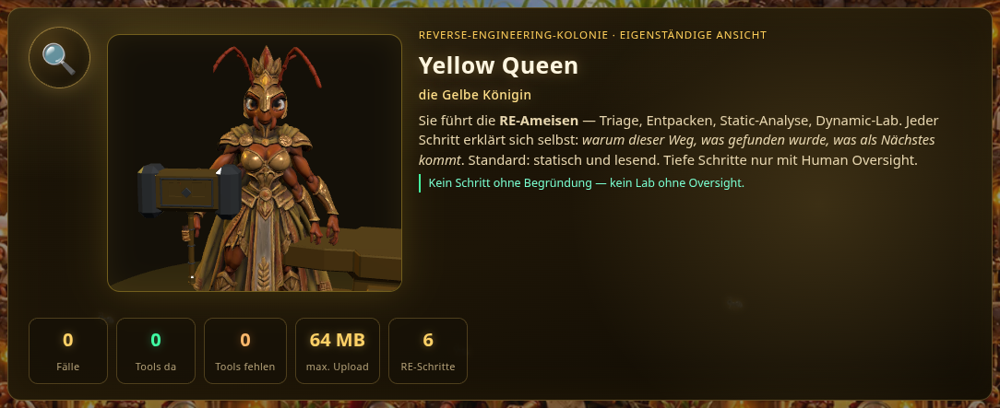

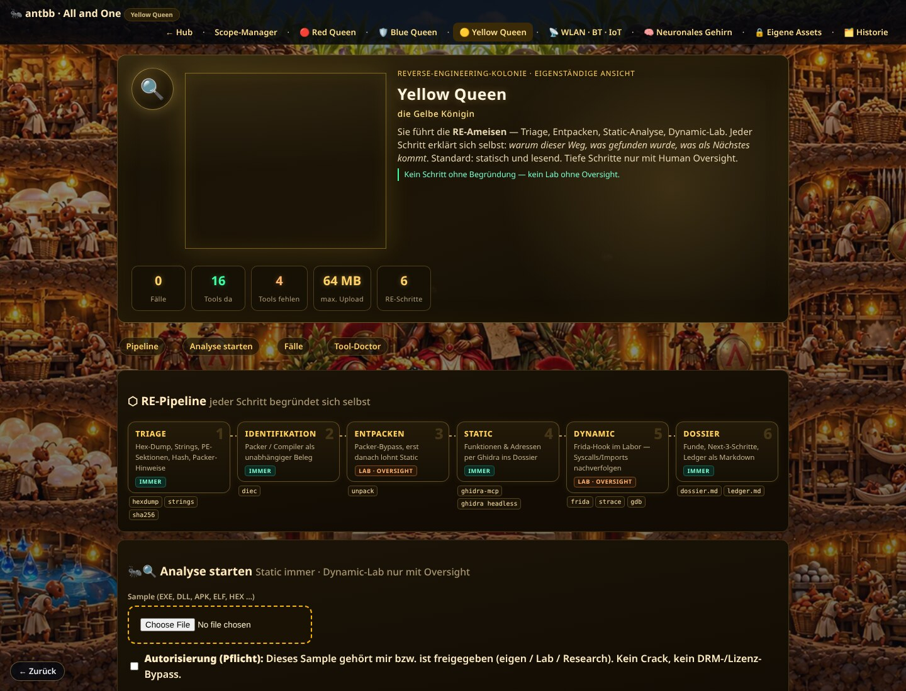

- **RE-Pipeline:** Triage (Hex/Strings/Sektionen) → Identifikation (diec) → Entpacken (Lab, Oversight) → Static (Ghidra) → Dynamic (Frida-Lab, Oversight) → Dossier.
- **Analyse starten:** Sample-Upload (EXE, DLL, SYS, APK, SO, ELF, BIN, HEX …) nur mit bestätigter Autorisierung; Dynamic-Lab nur mit Oversight.
- **Orchestrierung** (`yellow-queen/queen/orchestrator.py`): Fall anlegen (erst nach bestandenem Autorisierungs-Gate) → klassifizieren → Toolchain wählen → Soldaten ausführen → Ergebnisse in Dossier, Ledger und Neuronales Gehirn zusammenführen; jeder Hop wird begründet, die nächsten drei Schritte werden aus echten Funden abgeleitet.
- **Fälle** (`/yellow/case/{id}`, `/yellow/laeufe`): Hops, Next-3, Funde mit Adresse, Evidence-Links; je Fall `ledger.md` und `dossier.md` im Fallordner.
- **Tool-Doctor:** Werkzeugstatus (Ghidra, diec, Frida …) mit Pfad und Zweck.

---

## Gemeinsame Bereiche

### Hub (`/`)
Einstieg mit den drei Königinnen-Karten, Live-Status aus der Colony und Rechtshinweis.

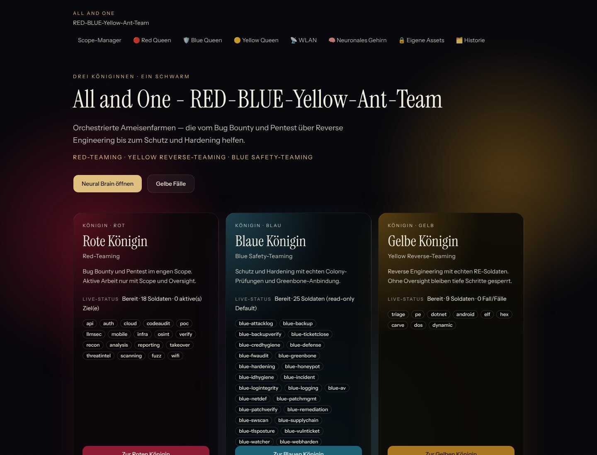

### Neuronales Gehirn (`/brain`)
Das Neuronale Gehirn speichert das Wissen der Plattform und zeigt es als 3D-Ameisenstadt: die Rote Königin auf dem Thron in der Mitte, die Blaue Königin in ihrem Wachviertel, die Gelbe Königin in ihrer Schmiede. Die Namensschilder folgen den echten 3D-Positionen; die Stadt ist drehbar. Die roten und blauen Soldaten-Schilder stammen live aus `/api/soldiers`, die gelben aus der statischen `YELLOW`-Liste in `antbb/web/static/brain/ants3d.js`. Ohne WebGL zeigt die Ansicht nur einen Text-Hinweis (Text-Fallback). Dazu Knoten-Panel mit Logs, Zeitraffer und Schwarm-Wiki (WER / WAS / WIE / WO / WARUM). Aliasse: `/red/brain`, `/blue/brain`, `/yellow/brain`.

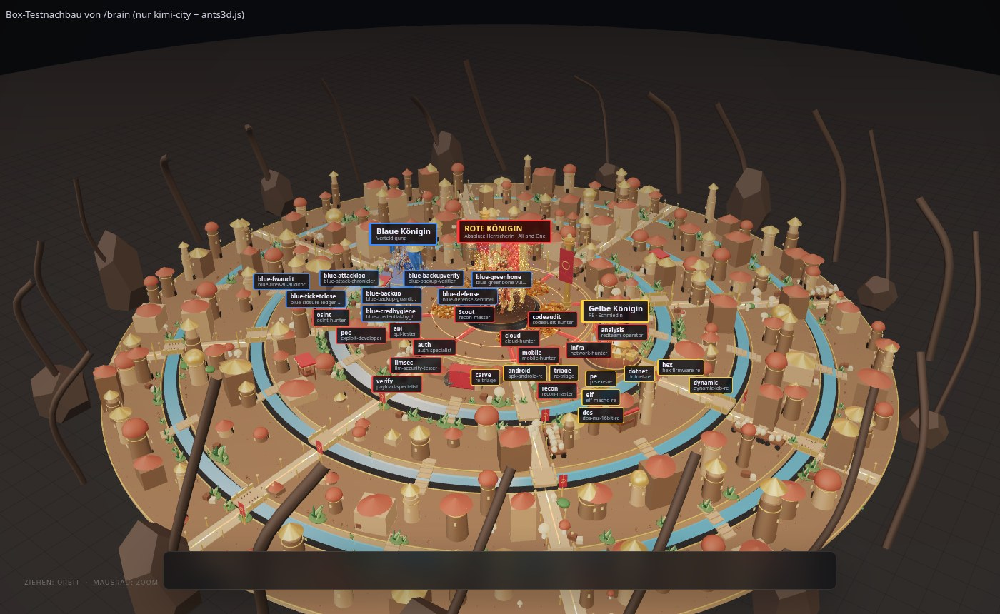

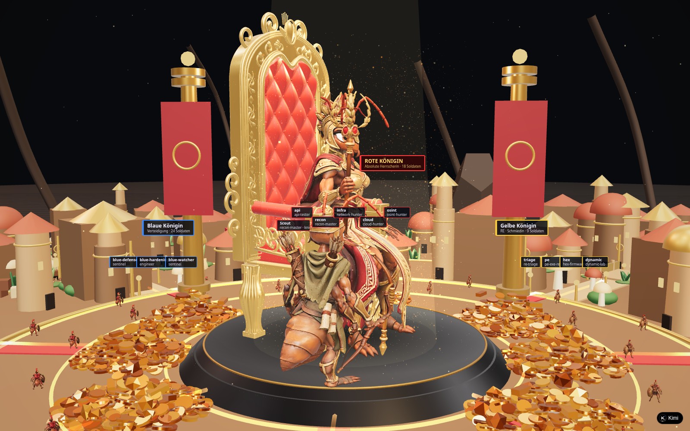

### Historie (`/history`)
Persistente Run-Historie aller Teams mit Zeitraffer sowie Export-Index (`GET /api/exports`, Download über `/exports/{name}` aus `data/exports/`).

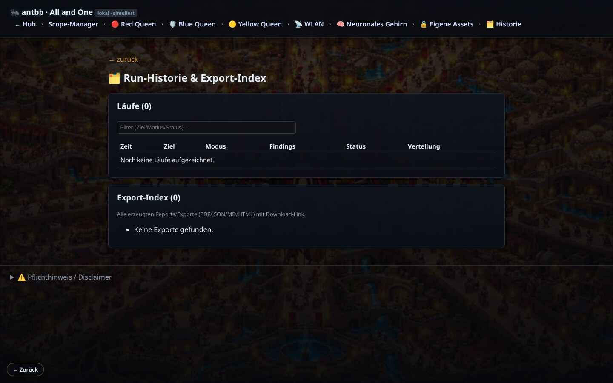

### Reports (alle Teams)
Feste Ablage je Königin unter `data/reports/<red|blue|yellow>/` (gitignored, da echte Befunde). Pro Lauf bzw. Fall entsteht ein HTML- und – mit weasyprint/wkhtmltopdf – ein PDF-Report (`antbb/report_store.py`, nutzt die bestehende Report-Logik).

| Team | Quelle | Erzeugen |
|---|---|---|
| Red | gebrandeter Ziel-Report (`brandedreport`) | `POST /api/reports/generate` mit `{"queen":"red","target_id":…}` |
| Blue | Lauf aus der Run-Historie + Ziel-Findings | `{"queen":"blue","run_id":…}` |
| Yellow | `dossier.md` / `ledger.md` des Falls | `{"queen":"yellow","case_id":…}` |

Übersicht und Erzeugen-Formular: `GET /reports`; Liste als JSON: `GET /api/reports`; Download: `GET /reports/<queen>/<datei>` (Dateinamen per Whitelist, Pfad per `resolve()` geprüft). In der Historie hat jeder Lauf einen **PDF**-Button.

### Weitere Routen
| Route | Inhalt |
|---|---|
| `/target/{id}` | Ziel-Detail: Scope, Oversight, Mode, Findings, Reports, Scan-Status |
| `/target/add` | Ziel anlegen |
| `/assets` | Eigene Assets (TLS-/Header-Checks) |
| `/trash` | Archivierte Ziele, wiederherstellbar |

---

## Architektur

Ein Prozess, ein Port (`:1001`), drei eingebettete Apps:

```
antbb.service (uvicorn, api.main:app)
├── /                Hub          → Next.js-Static-Export (all-and-one/out)
├── /red /blue       Kolonie      → antbb.web (FastAPI, Colony-Backup)
├── /yellow …        Yellow Queen → yellow_queen.web (FastAPI, RE-Orchestrierung)
├── /brain           Neuronales Gehirn → Colony-Brain (Three.js-Partikelfeld + nodes-panel + runs.js + queens.js)
├── /wlan /assets /history …     → Colony-Routen
└── /api/…           Queens-APIs, Targets, Runs, Feed, Capabilities, Blue-Jobs, …
```

- **Eine Adresse, same-origin**: alle Seiten und APIs hinter `http://<host>:1001` — kein CORS, kein Sidecar-Zwang.
- **Echte Daten nur**: keine Mocks im Endprodukt; jede Zahl kommt aus Registry, Store oder Tool-Ausgabe.
- **Statik**: `/static` merged aus Colony- und Yellow-Static; der Hub liefert aus `all-and-one/out`.

---

## Installation

Der vollständige Erststart (Benutzer `antbb`, Hash, Dienst) steht im [Schnellstart](#schnellstart). Die folgenden Schritte sind nur Klon, venv und optionale Extras.

Voraussetzungen: **Linux** (getestet auf Debian/Ubuntu), **Python ≥ 3.11**, **Node.js ≥ 20** (nur für den Hub-Build), git. WLAN-Features brauchen eine WLAN-Karte mit Monitor-Modus; Greenbone/optional.

### 1. Klonen & Umgebung

```bash
git clone https://github.com/krockodog/antbb-framework.git
cd antbb-framework
python3 -m venv .venv
.venv/bin/pip install -r requirements.txt
```

### 2. Konfiguration

```bash
cp antbb.env.example antbb.env   # chmod 600, niemals committen; der Hash darin ist Pflicht zum Start
```

Beim ersten `./run.sh` erscheint ein **KI-/Zugangs-Menü**:

1. **Eigene KI (API-Key)** — nur MiniMax (Pflicht-Angebot), Claude, ChatGPT, Gemini, Qwen, Mistral · Free  
2. **Ollama** — lokale Null-Euro-KI · Free  
3. **OAuth-Login** — Identifikation → **Plan-Version** (erweiterte Features)  
4. **Enter** — ohne KI · Free  

Gespeichert in `antbb.env`: `ANTBB_AI_MODE`, `ANTBB_EDITION=free|plan`, Provider/Keys. Details: `INSTALL.md`.

Weitere optionale Variablen (sane Defaults): `ANTBB_HOST`/`ANTBB_PORT`, `COLONY_DB`, `COLONY_DATA`, `YELLOW_QUEEN_ROOT`, `ANTBB_WIFI=1`, `GVM_USERNAME`/`GVM_PASSWORD`, `ANTBB_SPLUNK_HEC_URL/TOKEN`, `MINIMAX_API_KEY` (nur zur Laufzeit).

### 3. Hub bauen (Next.js Static Export)

```bash
cd all-and-one
npm ci
npm run build          # erzeugt out/
rm -f out/*.txt          # RSC-Payload-Dateien nicht ausliefern
cd ..
```

`all-and-one/out` ist der Webroot für `/`.

### 4. Starten

```bash
cd /opt/antbb && .venv/bin/python -m antbb.webauth hash-password
sudo systemctl enable --now antbb
# oder, mit gesourcter antbb.env, nicht als root:
.venv/bin/python -m api --host 127.0.0.1 --port 1001
```

`./run.sh` startet `install-and-start.sh` und bindet standardmäßig `127.0.0.1:8000`, nicht Port 1001. Der Dienst aus dem Schnellstart ist `antbb.service` (`User=antbb`, nur `127.0.0.1`). Eine andere Schnittstelle braucht `ANTBB_EXPOSE=1` und loggt eine Warnung. Als root startet der Prozess nicht.

Danach im Browser: `http://127.0.0.1:1001` — anmelden, Hub → Königin wählen → Ziel anlegen → Scope pflegen → Oversight → Kolonie starten.

### 5. Verifizieren

```bash
curl -s http://127.0.0.1:1001/api/health
# {"ok": true, "service": "all-and-one", "queen_ids": ["red","blue","yellow"]}
```

Danach im Browser: `http://<host>:1001` — Hub → Königin wählen → Ziel anlegen → Scope pflegen → Oversight → Kolonie starten.

> **Hinweis zum Installer:** `install.sh` / `install-and-start.sh` im Repo führen diese Schritte idempotent durch (Vereinigung, Skills/Playbooks-Seeds, Tool-Install je Queen, AI-Setup, Doctor/Preflight, Modi `--noninteractive`, `--doctor`, `--full`).

---

## Betrieb

- **Läufe starten**: Ziel im Scope-Manager anlegen → Scope-Einträge setzen → Oversight bestätigen → Kolonie starten (Lesend per Default; aktiv/offensiv nur mit Häkchen).
- **Scan-Tiefe**: *Leicht* (recon·scan·report) oder *Intensiv* (alle Phasen) — wählbar, landet im Start-Request und im Log.
- **Fix-Brücke**: Red-Finding → „In Blau reparieren" → echter Remediate-Job in `/blue`.
- **Backups**: Vor Patches legt die Plattform `*.bak-<zeitstempel>` an; DB-Backup vor „Alles löschen" im Gehirn.
- **Logs**: `journalctl -u antbb -f`.

---

## Leitplanken & Sicherheitsmodell

1. **Default-deny Scope** — leer heißt: kein Ziel, kein Lauf.
2. **Human Oversight** — aktive Schritte (Deauth, PoC, Fixes, Scans gegen Ziele, Tunnel) brauchen ein gesetztes Häkchen; der Rechtshinweis ersetzt es nicht.
3. **Proof-Gate** — „verifiziert" gilt erst mit Nachweis; Findings ohne Evidence bleiben Verdacht.
4. **Honest-empty** — was nicht geht, wird ehrlich als Ergebnis gemeldet (kein Fake-Status).
5. **Keine Secrets/PII** in Findings oder Reports; geknackte Passwörter werden maskiert, nie persistiert.
6. **Recht** — § 202a-c StGB / CFAA-Hinweis auf jeder Seite; nur autorisierte Ziele, nur eigene Geräte, nur eigene Netze.

---

## Roadmap

Offene Punkte (noch nicht umgesetzt):

- **Yellow:** Pfadfix in den Orchestrate-Schritten und Ghidra headless (`analyzeHeadless`) anbinden.
- **Persistenter Honeypot** mit Speicherung in `attack_events`.
- **Manipulationssicheres Audit-Log** (`/audit`).
- **Greenbone-Dienst** betriebsbereit machen (gvmd, `python-gvm`).
- **Watcher-Event-Quelle** (auditd) für die Blue Queen.

- **3D-Gebäude je Wissensstufe:** Die Ausbaustufe wird bereits berechnet und angezeigt; die passenden Gebäude in der 3D-Stadt fehlen noch.
- **Schaufenster-/Demo-Version ohne Backend:** statische Vorschau der Oberfläche ohne laufenden Server.
- **Echte Yellow-Soldaten-Daten:** Die gelben Schilder im Neuronalen Gehirn kommen derzeit aus einer statischen Liste in `ants3d.js` statt aus der API.
- **MiniMax M-Plan-Key:** Unterstützung des Abo-Schlüssels zusätzlich zum Pay-as-you-go-Key.
- **Blue-Remediation pro Befund:** gezielte Behebung und Re-Test je einzelnem Finding.
- **Echte Executor an `/api/queens/{q}/runs`:** Läufe über diese Route an reale Ausführung anbinden.

---

## Credits

| Beteiligte | Rolle |
|---|---|
| Judith Pilarski ([@krockodog](https://github.com/krockodog)) | Konzept, Architektur, Oversight, Maintainerin |
| Cursor ([@cursoragent](https://github.com/cursoragent)) | KI-gestützte Entwicklung |
| lordix | Commits aus der lokalen Entwicklungsumgebung |
| Red Queen (Plattform-Identität) | Commits zu Scan-Tools und Neuronalem Gehirn |
| Kimi Work | Commit „All and One: kompletter Stand 2026-10-25“ |

Grundlage ist die Autorenliste aus `git log`.

---

## Lizenz & Hinweis

Siehe [LICENSE](LICENSE). Dieses Framework ist für **autorisierte Sicherheitstests, eigene Labore und Aufklärungsarbeit** gebaut. Missbrauch gegen fremde Systeme ist strafbar und technisch durch das Scope-Gate ausgeschlossen — Tricks kennen heißt schützen können.
