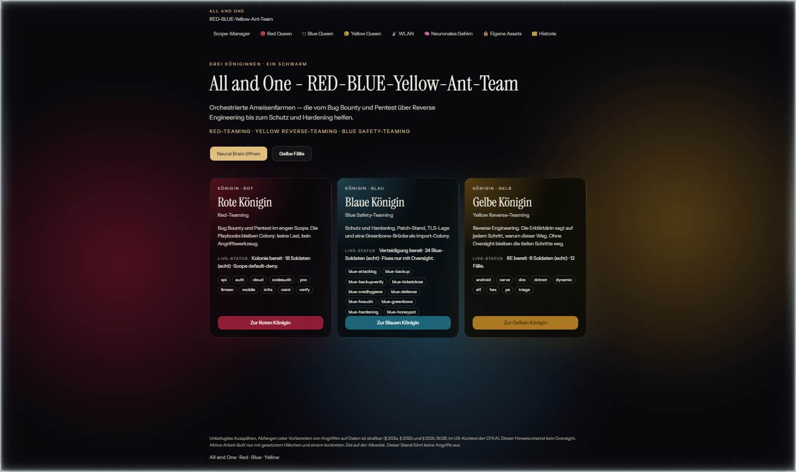
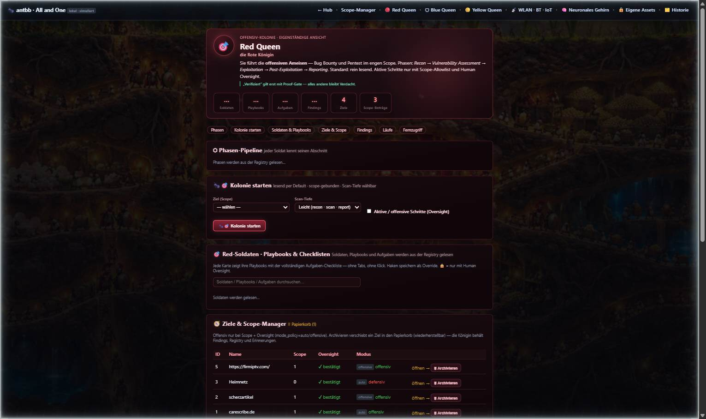
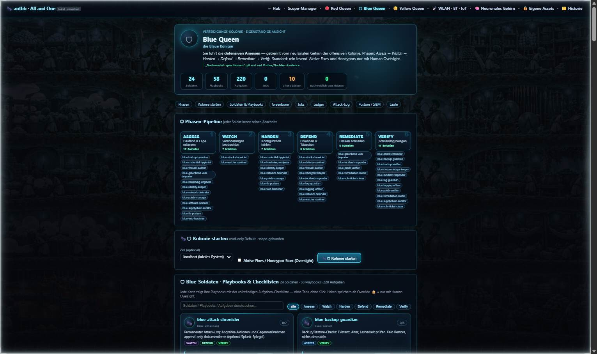
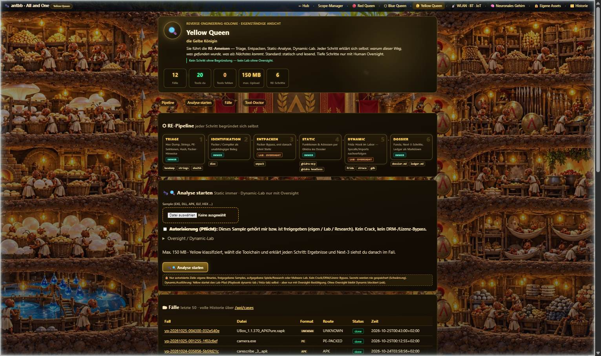
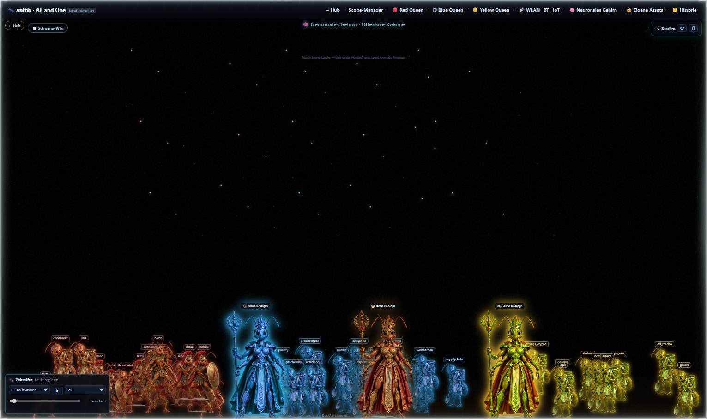
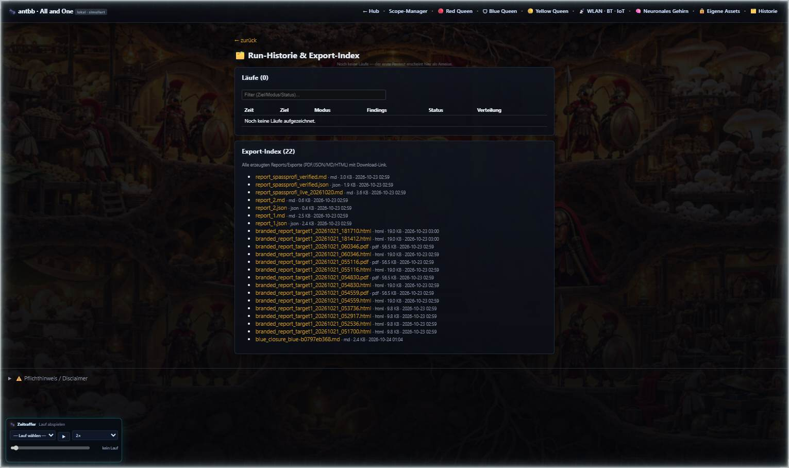
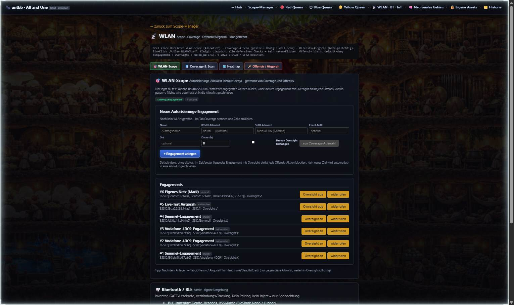

# All and One — RED · BLUE · Yellow · Ant-Team

**Orchestrierte Ameisenfarmen** — eine Plattform, drei Königinnen: Bug Bounty & Pentest (Red), Schutz & Hardening (Blue), Reverse Engineering (Yellow). Ein Framework, ein Prozess, eine Adresse.

> Unbefugtes Ausspähen, Abfangen oder Vorbereiten von Angriffen auf Daten ist strafbar (§ 202a–c StGB; im US-Kontext der CFAA). Dieser Hinweis ersetzt kein Oversight. Aktive Arbeit läuft nur mit gesetztem Häkchen und einem konkreten Ziel auf der Allowlist. Dieser Schwarm führt keine Angriffe aus.

---

## Inhalt

1. [Das Konzept](#das-konzept)
2. [Screenshots](#screenshots)
3. [Alle Menüpunkte im Detail](#alle-menüpunkte-im-detail)
4. [Architektur](#architektur)
5. [Installation](#installation)
6. [Betrieb](#betrieb)
7. [Leitplanken & Sicherheitsmodell](#leitplanken--sicherheitsmodell)
8. [Roadmap](#roadmap)

---

## Das Konzept

Drei Königinnen — ein Schwarm. Jede Königin führt ihre eigene Kolonie mit eigenen Soldaten, Playbooks und Farbe; geteilt werden **Scope (default-deny)**, **Human Oversight** und der **kanonische Beweis** (Proof-Gate: „verifiziert" gilt erst mit Nachweis — alles andere bleibt Verdacht).

| Königin | Farbe | Rolle | Kern |
|---|---|---|---|
| 🔴 **Rote Königin** | Rot | Red-Teaming | Bug Bounty & Pentest im engen Scope, 5-Phasen-Pipeline, Findings mit Proof-Gate und Fix-Brücke zur Blauen Königin |
| 🛡 **Blaue Königin** | Blau | Blue Safety-Teaming | Schutz & Hardening, 6-Phasen-Pipeline (Assess→Verify), Greenbone-Anbindung, Remediation mit Vorher/Nachher-Evidence |
| 🟡 **Gelbe Königin** | Gold | Yellow Reverse-Teaming | Reverse Engineering von Samples (EXE/DLL/APK/ELF/HEX), 6-stufige RE-Pipeline, jeder Schritt begründet sich selbst |
| 🧠 **Neuronales Gehirn** | alle | Schwarm-Wiki & Visualisierung | Drei Königinnen über drei farbigen Armeen, klickbare Knoten, Live-Logs, Zeitraffer, Schwarm-Wiki (wer macht was, wie, wo, warum) |

Die Kette im Betrieb: **Red** beweist den Angriffspfad → **Yellow** verifiziert offline (z. B. geknacktes WLAN-Passwort, maskiert) → **Blue** fixt mit Re-Test und sauberem Log & Report.

---

## Screenshots

### Hub (`/`)
Einstieg mit den drei Königinnen-Karten, Live-Status aus der echten Colony und Rechtshinweis.



### Rote Königin (`/red`)
Offensiv-Kolonie: Hero mit Echt-Statistiken, Phasen-Pipeline, Kolonie starten (Scan-Tiefe wählbar), Red-Team-Menü nach Scope-Auswahl, Soldaten & Playbooks, Ziele & Scope-Manager, Findings mit „In Blau reparieren"-Fix-Brücke, Läufe, Fernzugriff (Tailscale/Cloudflare).



### Blaue Königin (`/blue`)
Verteidigungs-Kolonie: Phasen-Pipeline (Assess → Watch → Harden → Defend → Remediate → Verify), Kolonie starten (read-only Default), Soldaten & Playbooks, Greenbone/OpenVAS (Import + Scoped Scan), wiederholbare Jobs, Posture-Ledger, Attack-Log, Posture/SIEM, Remediation, Läufe.



### Gelbe Königin (`/yellow`)
RE-Kolonie: RE-Pipeline (Triage → Identifikation → Entpacken → Static → Dynamic → Dossier), Sample-Upload mit Autorisierungs- und Oversight-Gate, Fälle, Tool-Doctor.



### Neuronales Gehirn (`/brain`)
Drei gleich große Königinnen — jede vor ihrer farblich passenden Armee (Bewegungs-Sektoren in `ants.js`). Knoten-Panel minimiert, Zeitraffer unten links, „📖 Schwarm-Wiki"-Overlay erklärt alle drei Kolonien (WER/WAS/WIE/WO/WARUM).



### Historie (`/history`)
Run-Historie aller Königinnen — inklusive Zeitraffer (Lauf auswählen, abspielen, 1×–8×, Scrubber).



### Funk-Labor (`/wlan`)
WLAN-Scope, Coverage & Scan, Heatmap, Offensiv/Airgorah (Engagement-Gate) — plus Bluetooth/BLE- und IoT-Lab-Karten (passiv frei, aktiv nur mit Oversight, Kette Red→Yellow→Blue).



---

## Alle Menüpunkte im Detail

Die Menüleiste ist auf **allen** Seiten identisch:

| Menüpunkt | Route | Beschreibung |
|---|---|---|
| ← Hub | `/` | Zurück zur Startseite |
| Scope-Manager | `/` | Hub: Königinnen-Übersicht, Live-Status, Einstieg |
| 🔴 Red Queen | `/red` | Offensiv-Kolonie (unten im Detail) |
| 🛡 Blue Queen | `/blue` | Verteidigungs-Kolonie (unten im Detail) |
| 🟡 Yellow Queen | `/yellow` | RE-Kolonie (unten im Detail) |
| 📡 WLAN · BT · IoT | `/wlan` | Funk-Labor: WLAN, Bluetooth/BLE, IoT (unten im Detail) |
| 🧠 Neuronales Gehirn | `/brain` | Schwarm-Visualisierung, Knoten, Logs, Zeitraffer, Wiki |
| 🔒 Eigene Assets | `/assets` | Asset-Register der eigenen Systeme |
| 🗂️ Historie | `/history` | Persistente Run-Historie aller Kolonien + Zeitraffer |

### `/` — Hub
- **Drei Königinnen-Karten** mit Live-Status aus der echten Colony (Soldaten, Scope-Status).
- Buttons: *Neural Brain öffnen* (`/brain`), *Gelbe Fälle* (`/yellow`).
- Rechtshinweis im Footer (§ 202a-c StGB / CFAA).

### `/red` — Rote Königin (Red-Teaming)
- **Hero + Statistiken**: Soldaten, Playbooks, Aufgaben, Findings, Ziele, Scope-Einträge — alles echte Werte aus der Registry.
- **⬡ Phasen-Pipeline**: Recon → Vulnerability Assessment → Exploitation → Post-Exploitation → Reporting (aus der Capability-Registry; defensiv/offensiv gekennzeichnet).
- **🐜🎯 Kolonie starten**: Ziel (Scope) wählen, Scan-Tiefe *Leicht/Intensiv*, optional aktive/offensive Schritte mit Oversight-Häkchen. Live-Feed per Polling.
- **🎛 Red-Team-Menü** (erscheint nach Ziel-Auswahl): Recon & OSINT · Schwachstellen-Scan · Aktive Verifikation 🔒 · PoC aus Evidence 🔒 · LLM-Security · Reporting. 🔒-Punkte sind ohne Oversight-Häkchen gesperrt; jeder Klick legt einen echten Lauf an.
- **Soldaten & Playbooks**: Karten aller 18 Rot-Soldaten mit Playbooks, Tools und abhakbaren Aufgaben (Haken = Override, gespeichert über die API), SKILL.md-Dialog pro Soldat, Volltext-Filter.
- **🧭 Ziele & Scope-Manager**: Ziele anlegen (Name, Beschreibung, mode_policy), Scope-Einträge, Oversight-Status, Modus, Archivieren (Soft-Delete in `/trash`).
- **🕷 Findings**: aggregiert über alle Ziele, nach Schwere sortiert; **„🛡 In Blau reparieren"** erzeugt einen echten Remediate-Job in `/blue` (Fix-Brücke).
- **🗂 Läufe**: persistente Historie (ohne Blue-Läufe).
- **🔐 Fernzugriff**: Aus (nur lokal) / Tailscale / Cloudflare-Tunnel — Modus wählen, Tunnel mit Oversight starten/stoppen.

### `/blue` — Blaue Königin (Blue Safety-Teaming)
- **Hero + Statistiken**: Soldaten, Playbooks, Aufgaben, Jobs, offene Lücken, nachweislich geschlossen.
- **⬡ Phasen-Pipeline**: Assess → Watch → Harden → Defend → Remediate → Verify.
- **🐜🛡 Kolonie starten**: read-only Default, scope-gebunden; aktive Fixes/Honeypots nur mit Oversight-Häkchen.
- **Soldaten & Playbooks**: 24 Blue-Soldaten mit Checklisten, 🔒-Markierung für Oversight-Pflicht.
- **🌿 Greenbone / OpenVAS**: Report-Import (XML/CSV/JSON, rein lesend) und Scoped Scan (ein In-Scope-Host, Oversight-Pflicht).
- **⏱ Jobs**: wiederholbare Checks (Software-Scan, Hardening, Remediation-Verify, …) mit Intervall und manuellem Auslösen.
- **🧾 Posture-Ledger**: Vorher/Nachher über Läufe — „nachweislich geschlossen" nur mit Re-Check.
- **🕷 Attack-Log**: append-only Protokoll (Detection, Honeypot-Umleitung, Gegenmaßnahme).
- **📡 Posture / SIEM**: Splunk-HEC-Status (optional) + Leitplanken.
- **🛠 Remediation**: Findings mit prüfbarem Fix und Oversight-Gate.
- **🗂 Blue-Läufe**: nur colony=blue.

### `/yellow` — Gelbe Königin (Yellow Reverse-Teaming)
- **Hero + Statistiken**: Fälle, Tools da/fehlend (Tool-Doctor), max. Upload, RE-Schritte.
- **⬡ RE-Pipeline**: Triage (Hex/Strings/Sektionen) → Identifikation (diec) → Entpacken (Lab 🔒) → Static (Ghidra) → Dynamic (Frida-Lab 🔒) → Dossier.
- **🐜🔍 Analyse starten**: Sample-Upload (EXE, DLL, SYS, APK, SO, ELF, BIN, HEX, …) mit **Autorisierungs-Pflicht**-Häkchen; Dynamic-Lab nur mit Oversight. Danach: Fall-Seite mit Next-3-Schritten, Funden, Begründung je Schritt.
- **🗂 Fälle**: letzte 50 Fälle (Format, Route, Status, Zeit), volle Historie über `/api/cases`.
- **🧰 Tool-Doctor**: Werkzeug-Status (Ghidra, diec, Frida, …) mit Pfad und Zweck.

### `/brain` — Neuronales Gehirn
- **Drei Königinnen** (gleich groß, korrekte Farben, Labels) vor ihren farbigen Armeen — Armeen wandern in ihren Sektoren (blau 20–42 %, rot 42–58 %, gelb 58–80 %).
- **Knoten-Panel** (rechts, minimiert aufklappbar): Knoten mit Status, Detail-Dialog, Logs-Tab, Löschen nur mit Menschen-Bestätigung.
- **Zeitraffer** (unten links): Lauf auswählen, abspielen, Geschwindigkeit, Scrubber.
- **📖 Schwarm-Wiki**: Overlay mit allen drei Königinnen nach dem Schema WER / WAS / WIE / WO / WARUM + geteilte Leitplanken.
- **Ameisen-Overlay**: laufende Soldaten mit Namensschildern, keine Spiegelschrift.

### `/wlan` — Funk-Labor (WLAN · BT · IoT)
- **WLAN-Scope** (Allowlist), **Coverage & Scan** (passiv + Königin-Voll-Scan), **Heatmap**, **Offensiv/Airgorah** (Engagement + Oversight + `ANTBB_WIFI=1`).
- **🦷 Bluetooth / BLE** (passiv): Inventar, GATT-Lesekarte, Verbindungs-Tracking; BT-Verifikation 🔒 nur an eigenen Geräten.
- **🔌 IoT-Lab** (eigene Geräte): Inventar (FritzBox/mDNS/SSDP), MQTT-Audit, Zigbee/Z-Wave-Karte, Default-Cred-Check; Kette Red → Yellow → Blue.

### Weitere Routen
| Route | Inhalt |
|---|---|
| `/target/{id}` | Ziel-Detail: Scope-Einträge, Oversight, Mode, Findings, Reports (mit Addenda & Revisionen), Scan-Status |
| `/target/add` | Ziel-Anlage-Formular (GET) / Anlegen (POST) |
| `/assets` | Eigene Assets (Web-Assets, TLS-/Header-Checks) |
| `/history` | Run-Historie aller Kolonien + Zeitraffer |
| `/trash` | Papierkorb (archivierte Ziele, wiederherstellbar) |
| `/yellow/case/{id}` | Fall-Dossier: Hops, Next-3, Funde mit Adresse, Bypass/Dynamic-Status, Evidence-Links |
| `/yellow/laeufe` | Gelbe Dossiers |
| `/red/brain`, `/blue/brain`, `/yellow/brain` | Aliasse auf das geteilte neuronale Gehirn |

---

## Architektur

Ein Prozess, ein Port (`:1001`), drei eingebettete Apps:

```
antbb.service (uvicorn, api.main:app)
├── /                Hub          → Next.js-Static-Export (all-and-one/out)
├── /red /blue       Kolonie      → antbb.web (FastAPI, Colony-Backup)
├── /yellow …        Yellow Queen → yellow_queen.web (FastAPI, RE-Orchestrierung)
├── /brain           Gehirn      → Colony-Brain (Three.js-Partikelfeld + nodes-panel + runs.js + queens.js)
├── /wlan /assets /history …     → Colony-Routen
└── /api/…           Queens-APIs, Targets, Runs, Feed, Capabilities, Blue-Jobs, …
```

- **Eine Adresse, same-origin**: alle Seiten und APIs hinter `http://<host>:1001` — kein CORS, kein Sidecar-Zwang.
- **Echte Daten nur**: keine Mocks im Endprodukt; jede Zahl kommt aus Registry, Store oder Tool-Ausgabe.
- **Statik**: `/static` merged aus Colony- und Yellow-Static; der Hub liefert aus `all-and-one/out`.

---

## Installation

Voraussetzungen: **Linux** (getestet auf Debian/Ubuntu), **Python ≥ 3.11**, **Node.js ≥ 20** (nur für den Hub-Build), git. WLAN-Features brauchen eine WLAN-Karte mit Monitor-Modus; Greenbone/optional.

### 1. Klonen & Umgebung

```bash
git clone https://github.com/krockodog/antbb-framework.git
cd antbb-framework
python3 -m venv .venv
.venv/bin/pip install -r requirements.txt
```

### 2. Konfiguration

```bash
cp antbb.env.example antbb.env   # Werte eintragen; niemals committen (gitignore sicher)
```

Wichtige Variablen (alle optional, sane Defaults): `ANTBB_HOST`/`ANTBB_PORT` (Surface), `COLONY_DB`, `COLONY_DATA`, `YELLOW_QUEEN_ROOT`, `ANTBB_WIFI=1` (aktiviert das WLAN-Offensiv-Modul), `GVM_USERNAME`/`GVM_PASSWORD` (Greenbone), `ANTBB_SPLUNK_HEC_URL/TOKEN` (SIEM), `MINIMAX_API_KEY` (nur zur Laufzeit).

### 3. Hub bauen (Next.js Static Export)

```bash
cd all-and-one
npm ci
npm run build          # erzeugt out/
rm -f out/*.txt          # RSC-Payload-Dateien nicht ausliefern
cd ..
```

`all-and-one/out` ist der Webroot für `/`.

### 4. Starten

```bash
./run.sh                      # oder:
.venv/bin/python -m uvicorn api.main:app --host 0.0.0.0 --port 1001
```

Als Dienst (systemd, Auszug):

```ini
[Unit]
Description=All and One - RED-BLUE-Yellow-Ant-Team
After=network-online.target

[Service]
Type=simple
WorkingDirectory=/opt/antbb
Environment=ALLONE_HOST=0.0.0.0
Environment=ALLONE_PORT=1001
Environment=ALLONE_WEB_ROOT=/opt/antbb/all-and-one/out
Environment=PYTHONPATH=/opt/antbb
ExecStart=/opt/antbb/.venv/bin/python -m uvicorn api.main:app --host 0.0.0.0 --port 1001
Restart=on-failure

[Install]
WantedBy=multi-user.target
```

### 5. Verifizieren

```bash
curl -s http://127.0.0.1:1001/api/health
# {"ok": true, "service": "all-and-one", "queen_ids": ["red","blue","yellow"]}
```

Danach im Browser: `http://<host>:1001` — Hub → Königin wählen → Ziel anlegen → Scope pflegen → Oversight → Kolonie starten.

> **Hinweis zum Installer:** `install.sh` / `install-and-start.sh` im Repo führen diese Schritte idempotent durch (Vereinigung, Skills/Playbooks-Seeds, Tool-Install je Queen, AI-Setup, Doctor/Preflight, Modi `--noninteractive`, `--doctor`, `--full`).

---

## Betrieb

- **Läufe starten**: Ziel im Scope-Manager anlegen → Scope-Einträge setzen → Oversight bestätigen → Kolonie starten (Lesend per Default; aktiv/offensiv nur mit Häkchen).
- **Scan-Tiefe**: *Leicht* (recon·scan·report) oder *Intensiv* (alle Phasen) — wählbar, landet im Start-Request und im Log.
- **Fix-Brücke**: Red-Finding → „In Blau reparieren" → echter Remediate-Job in `/blue`.
- **Backups**: Vor Patches legt die Plattform `*.bak-<zeitstempel>` an; DB-Backup vor „Alles löschen" im Gehirn.
- **Logs**: `journalctl -u antbb -f`.

---

## Leitplanken & Sicherheitsmodell

1. **Default-deny Scope** — leer heißt: kein Ziel, kein Lauf.
2. **Human Oversight** — aktive Schritte (Deauth, PoC, Fixes, Scans gegen Ziele, Tunnel) brauchen ein gesetztes Häkchen; der Rechtshinweis ersetzt es nicht.
3. **Proof-Gate** — „verifiziert" gilt erst mit Nachweis; Findings ohne Evidence bleiben Verdacht.
4. **Honest-empty** — was nicht geht, wird ehrlich als Ergebnis gemeldet (kein Fake-Status).
5. **Keine Secrets/PII** in Findings oder Reports; geknackte Passwörter werden maskiert, nie persistiert.
6. **Recht** — § 202a-c StGB / CFAA-Hinweis auf jeder Seite; nur autorisierte Ziele, nur eigene Geräte, nur eigene Netze.

---

## Roadmap

Bewusst **nicht** als Mock eingebaut — diese Bausteine brauchen echte Hardware bzw. Zugänge:

- **Geräte-Agenten**: Flipper Zero, Ghost ESP, ESP32-Marauder, BleShark Nano, AI-ESP32 als checkbare Workflow-Schritte mit automatischer Evidence (Geräte-Registry + Treiber-Schicht).
- **Yellow-Crack-Pipeline**: aircrack-ng / hashcat / john mit lokalen Wortlisten, komplett offline, maskierte Ergebnisse, Schwellenlogik (trivial/schwach → Blue-Ticket).
- **Blue-Konnektoren**: FritzBox (TR-064/LUA) für WPS aus / Passwort-Rotation / Gastnetz-Segmentierung; Freigabe-Matrix (auto / 1-Klick / 4-Augen) mit Dry-Run-Diff, Apply, Verify, Rollback.
- **Gedächtnis-Speicher**: `/history` als kollektives Gedächtnis (Tricks, Gegenmittel, Lehren, verlinkt auf Evidence).
- **Debrief-Dashboard**: Katz-und-Maus-Scoreboard (Angriffe vs. Abwehr je Klasse), Residual-Risk-Trend, Export PDF/PPTX für Kunden-Aufklärung.

---

## Lizenz & Hinweis

Siehe [LICENSE](LICENSE). Dieses Framework ist für **autorisierte Sicherheitstests, eigene Labore und Aufklärungsarbeit** gebaut. Missbrauch gegen fremde Systeme ist strafbar und technisch durch das Scope-Gate ausgeschlossen — Tricks kennen heißt schützen können.
