<p align="center">
  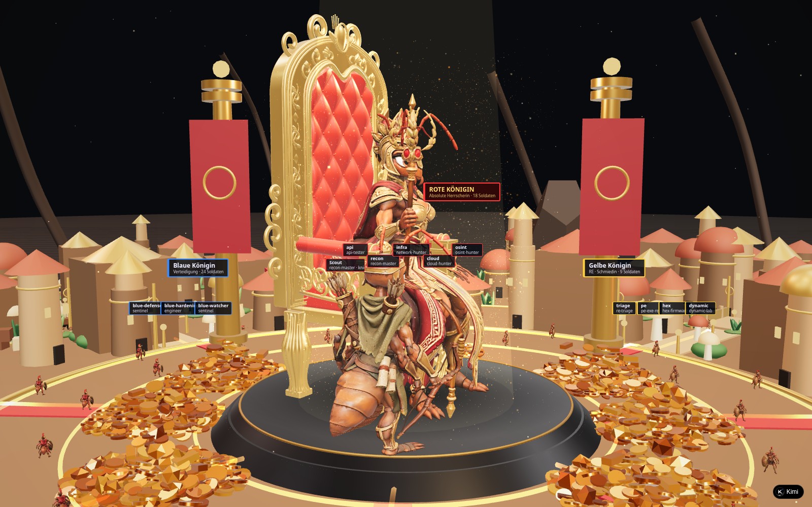
</p>

<h1 align="center">All and One - RED-BLUE-Yellow-Ant-Team</h1>

<p align="center">
Bug bounty and pentest (Red), protection and hardening (Blue), reverse engineering (Yellow). One process, one port, one address.
</p>

Deutsch: [README.de.md](README.de.md)

<p align="center">
  
  
  
  
  
  
  
</p>

Every real result — targets, runs, findings, logs — adds to the wealth of the ant city, and that growth has no last stage: knowledge itself is its prosperity. The more knowledge and power a queen gathers, the better she knows how to lead her people, where to send them, and how to protect them. The city's building stage is already calculated from the real counters and shown on screen (from 1 hut, 10 wells, 50 stone houses, 200 towers, 1000 modern buildings). The matching 3D buildings are still in progress.

> Probing, intercepting, or preparing attacks on data without permission is a crime (German Criminal Code § 202a–c; in the US, the CFAA). Active work runs only with a confirmed Human Oversight and a concrete target inside the scope. The notice does not replace Oversight.

## Quick start

A fresh clone on Linux (tested on Debian/Ubuntu). The unit [`deploy/antbb.service`](deploy/antbb.service) runs as `User=antbb` / `Group=antbb`, with `WorkingDirectory=/opt/antbb`, and reads `/opt/antbb/antbb.env`. The `useradd` line is the one in [DEPLOY.md](DEPLOY.md). On Debian/Ubuntu it creates the `antbb` group the unit requires; `--create-home` creates `/opt/antbb`. Because that directory already exists, clone beside it and copy with the `rsync` from `DEPLOY.md`.

```bash
# Account antbb, group antbb, home /opt/antbb
sudo useradd --system --create-home --home-dir /opt/antbb --shell /usr/sbin/nologin antbb
git clone https://github.com/krockodog/antbb-framework.git
sudo rsync -a --exclude .git --exclude antbb.env --exclude data ./antbb-framework/ /opt/antbb/
# Interpreter the unit executes: /opt/antbb/.venv/bin/python
sudo python3 -m venv /opt/antbb/.venv
sudo /opt/antbb/.venv/bin/pip install -r /opt/antbb/requirements.txt
sudo cp /opt/antbb/antbb.env.example /opt/antbb/antbb.env
sudo chmod 600 /opt/antbb/antbb.env
# Prompts for the password. Does not take it as an argument. Prints only the hash.
cd /opt/antbb && sudo .venv/bin/python -m antbb.webauth hash-password
```

As root, write the printed line into `/opt/antbb/antbb.env` as `ANTBB_ADMIN_PASSWORD_HASH=...` (format `pbkdf2_sha256:<iterations>:<salt_hex>:<hash_hex>`). If `ANTBB_ADMIN_USER` is unset, the account name is `admin`. Then hand the tree to `antbb`, or that user cannot read a mode-600 file owned by root:

```bash
sudo chown -R antbb:antbb /opt/antbb
sudo cp /opt/antbb/deploy/antbb.service /etc/systemd/system/antbb.service
sudo systemctl daemon-reload
sudo systemctl enable --now antbb
```

Direct start, also as `antbb`. `python -m api` does not read `antbb.env` by itself; systemd loads it through `EnvironmentFile`. In a shell, source it in the same session:

```bash
sudo -u antbb bash -c 'cd /opt/antbb && set -a && . ./antbb.env && set +a && exec .venv/bin/python -m api --host 127.0.0.1 --port 1001'
```

Then open http://127.0.0.1:1001/login

> Without `ANTBB_ADMIN_PASSWORD_HASH` or `ANTBB_ADMIN_PASSWORD` the process does not start. There is no default password.
>
> Do not run it as root. The entry points refuse. The unit sets `User=antbb`.
>
> The default is `ANTBB_EXPOSE=0`: the bind stays `127.0.0.1` (loopback only). Network access is the one-line switch `ANTBB_EXPOSE=1`, which prints a warning. Prefer an SSH tunnel.
>
> From another machine, use an SSH tunnel (`ssh -L 1001:127.0.0.1:1001 <user>@<host>`) and open the same URL locally. Do not publish the port.

`./run.sh` is the other launcher. It calls `install-and-start.sh`, sources `antbb.env` itself, and binds `127.0.0.1:8000` by default, not port 1001. It also refuses root, a missing hash, and a bind beyond loopback without `ANTBB_EXPOSE=1`.

## Contents

1. [Quick start](#quick-start)
2. [Overview](#overview)
3. [Red Queen – Offensive security](#red-queen--offensive-security)
4. [Blue Queen – Protection and hardening](#blue-queen--protection-and-hardening)
5. [Yellow Queen – Reverse engineering](#yellow-queen--reverse-engineering)
6. [Shared areas](#shared-areas)
7. [Architecture](#architecture)
8. [Installation](#installation)
9. [Operation](#operation)
10. [Guardrails and safety model](#guardrails-and-safety-model)
11. [Roadmap](#roadmap)
12. [Credits](#credits)
13. [License and notice](#license-and-notice)

## Overview

| Team | Role | Core |
|---|---|---|
| **Red Queen** | Red-Teaming | Bug bounty and pentest inside a tight scope, 5-phase pipeline, findings with a proof gate, a fix bridge to Blue, radio lab (WLAN/BT/IoT) with a scout |
| **Blue Queen** | Blue Safety-Teaming | Protection and hardening, 6-phase pipeline (Assess to Verify), Greenbone connection, remediation with before/after evidence |
| **Yellow Queen** | Yellow Reverse-Teaming | Reverse engineering of samples (EXE/DLL/APK/ELF/HEX), 6-step RE pipeline with a reason on every step |

How they fit: **Red** proves the attack path, **Yellow** verifies it offline, **Blue** fixes it, tests again, and writes it down.

| Red Queen | Blue Queen | Yellow Queen |
|---|---|---|
| 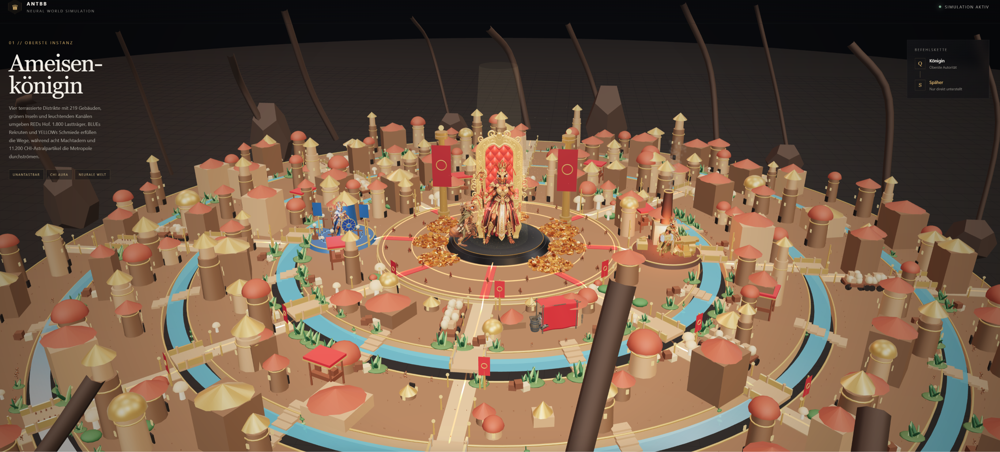 |  |  |

*Real renders of the 3D models from `antbb/web/static/brain/queen-viewer.js` (WebGL).*

Shared guardrails for every team (scope default-deny, Human Oversight, proof gate, honest-empty, defensive default, non-destructive find-and-prove): see [Guardrails and safety model](#guardrails-and-safety-model).

## Red Queen – Offensive security

Route `/red`. 18 soldiers with playbooks, tools, and tasks you can tick off.

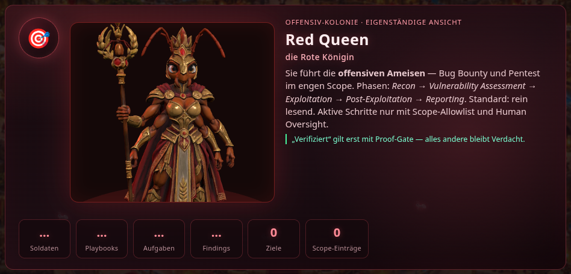

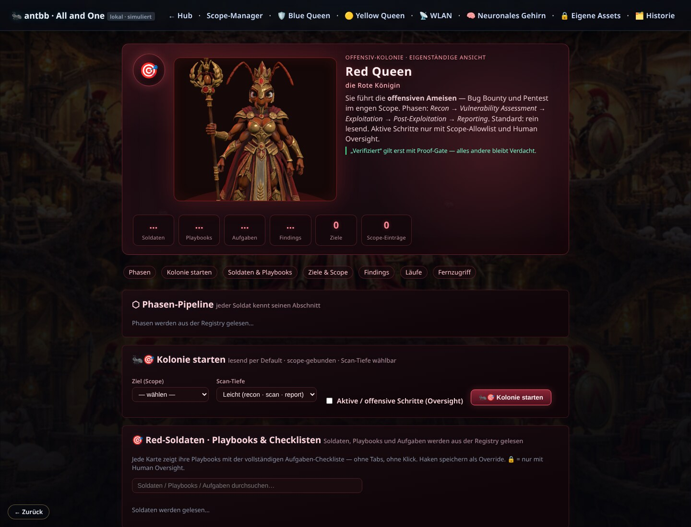

**What it does**

- **Statistics:** soldiers, playbooks, tasks, findings, targets, scope entries. Real values from the registry.
- **Phase pipeline:** Recon, Vulnerability Assessment, Exploitation, Post-Exploitation, Reporting (marked defensive or offensive).
- **Red-team menu** (after a target is selected): Recon and OSINT, vulnerability scan, active verification (Oversight), PoC from evidence (Oversight), LLM security, reporting. Each click creates a real run.
- **Targets and scope manager:** create targets (name, description, `mode_policy`), scope entries, Oversight status, archive (`/trash`), undo of the last scope or target change. Undo never sets Oversight.
- **Findings:** across all targets, sorted by severity. "Repair in Blue" creates a real remediate job in `/blue`.
- **Remote access:** local, Tailscale, or a Cloudflare tunnel. Start only with an Oversight confirmation.

**How a run is orchestrated** (`antbb/web/app.py`, `antbb/service.py`)

1. Create a target and maintain scope entries (`/target/add`, `/target/{id}`).
2. Confirm Oversight for that target (`POST /target/{id}/oversight`).
3. Start the colony. Scan depth *Light* is recon, scan, report. *Intensive* is every phase. Active or offensive steps need the extra Oversight checkbox.
4. The run starts as a background thread (`_start_scan_async` calls `svc.run_scan`). Only one scan runs at a time; otherwise HTTP 409. Without Oversight the run ends with status `error`.
5. Events appear in the live feed. When the run finishes, the severity spread, the findings, and the run entry are stored in History.

### Radio lab (`/wlan`)

WLAN scope (allowlist), coverage and scan (passive, and a queen full scan of defensive checks only), heatmap, offensive/Airgorah, plus Bluetooth/BLE and IoT lab cards.

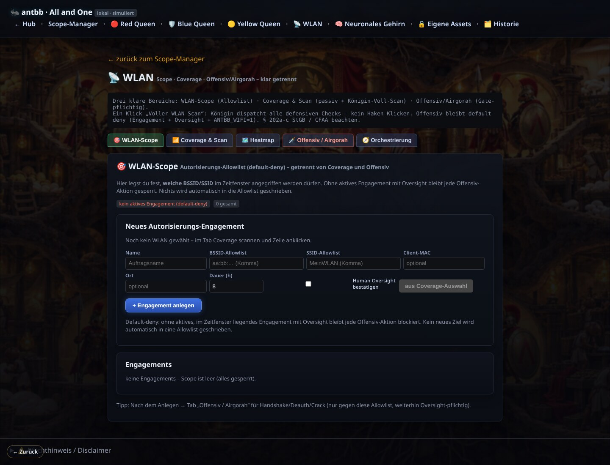

**Scout:** On the *Coverage & Scan* tab, `/wlan` shows the WLAN scout as a 3D model (`queen-viewer.js`, model `archer.glb`) next to the queen full scan and the devices that were seen. Without WebGL the page shows only the text "WebGL nicht verfügbar".

| Scout |
|---|
|  |

*A real render of the scout model (`archer.glb`) from `queen-viewer.js`, in the same style as the queens.*

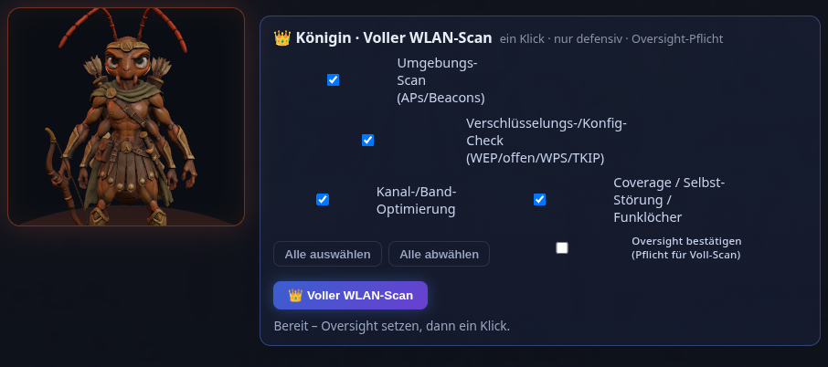

Devices seen in the radio lab:

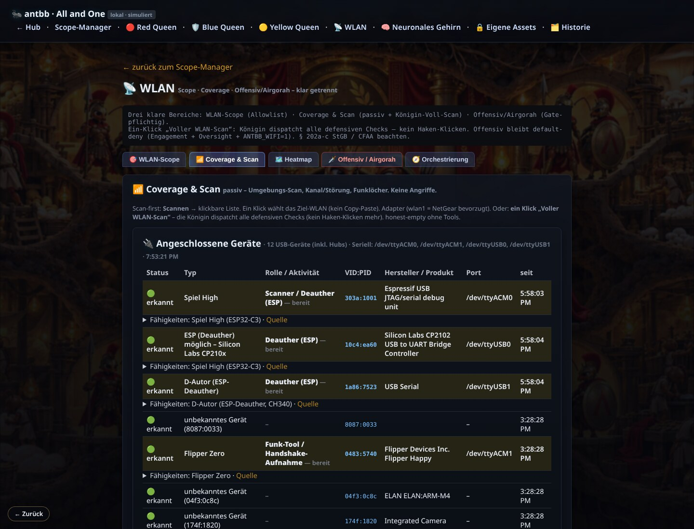

| Tab | Picture |
|---|---|
| Coverage and scan | 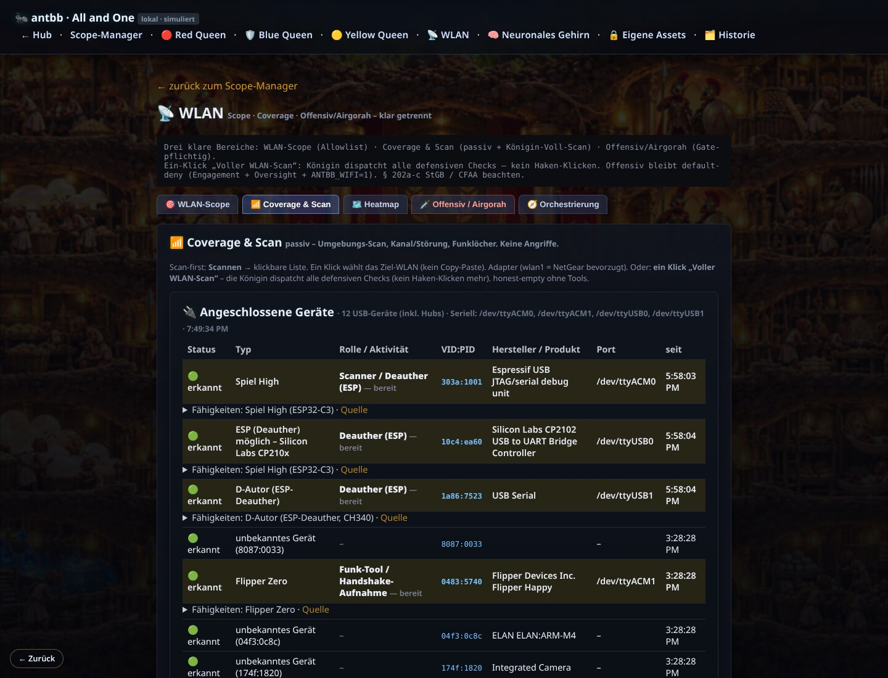 |
| Heatmap | 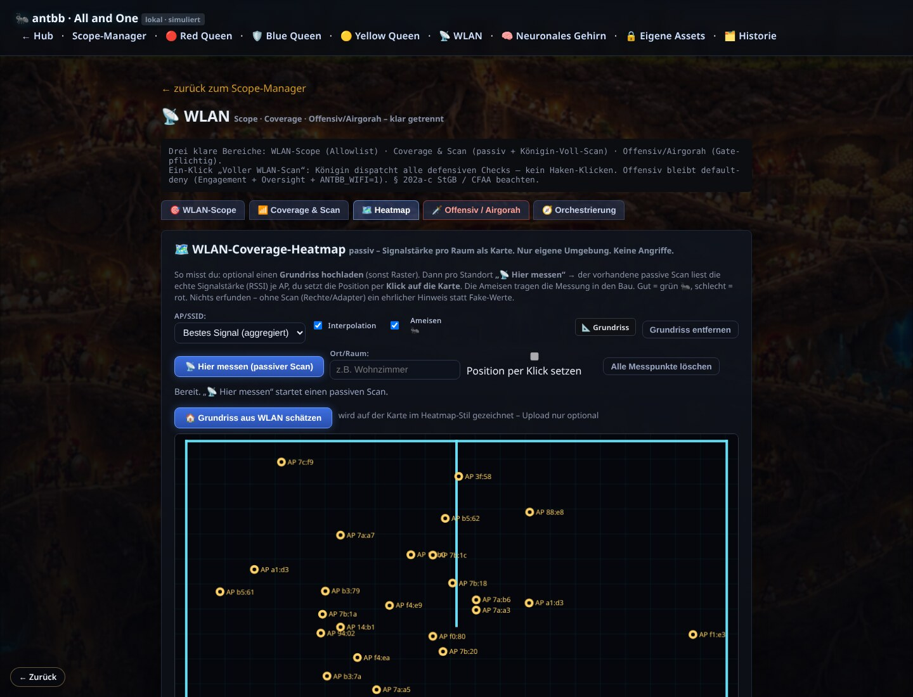 |
| Offensive/Airgorah | 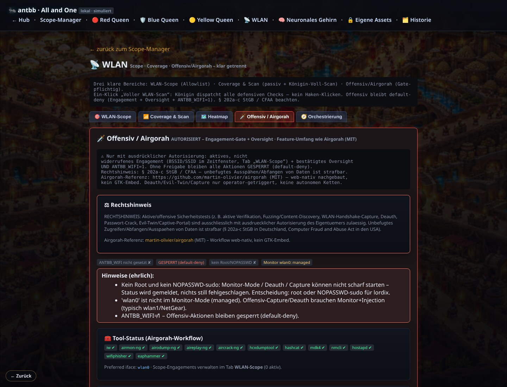 |

- **Gates in the radio lab:** passive coverage scans need no engagement. The client query requires an Oversight confirmation. Offensive actions need the engagement gate, Oversight, and `ANTBB_WIFI=1`.
- **Offensive/Airgorah:** a web-native audit layer (`antbb/wlan_airgorah.py`) shaped after [Airgorah](https://github.com/martin-olivier/airgorah) (MIT): interface and monitor-mode status, AP and client list, handshake/PMKID, a targeted deauth, offline crack. No Airgorah code is embedded. Sharp actions go only through `wlan_offensive`, with the engagement gate, Oversight, and `ANTBB_WIFI=1`. No autonomous chains.
- **Bluetooth/BLE** (passive): inventory, a GATT read map, connection tracking. Verification only on your own devices, with Oversight.
- **IoT lab** (your own devices): inventory (FritzBox/mDNS/SSDP), MQTT audit, Zigbee/Z-Wave map, default-credential check. The chain is Red, then Yellow, then Blue.

### Reports (Red, per target)

- `GET /target/{id}/branded-report` – branded HTML report (company, logo, color, title, and customer as parameters).
- `GET /target/{id}/report/print` – a print view (browser: Print, then Save as PDF).
- `GET /target/{id}/report.pdf` – PDF download through weasyprint or wkhtmltopdf. With no engine, an honest HTML fallback.
- `GET /report/{id}/view` and `GET /report/{id}/export?format=md|json` – Markdown view, or an export into `data/exports/`. Addenda and revisions go through `/report/{id}/addendum` and `/report/{id}/revisions`.

## Blue Queen – Protection and hardening

Route `/blue`. 25 soldiers (Greenbone, Hardening, Watcher, AV/ClamAV, Remediation, re-check).

> **Operating note (inventory of 1 November 2026):** Greenbone is built in. On the reference laptop the service is not running (`gvmd`, the socket, and `python-gvm` are missing). Importing a report from a file works. The ClamAV scan is real. `freshclam` and `clamd` are not running there as services. Canaries and traps are real, but they listen only on loopback and they are not persistent.

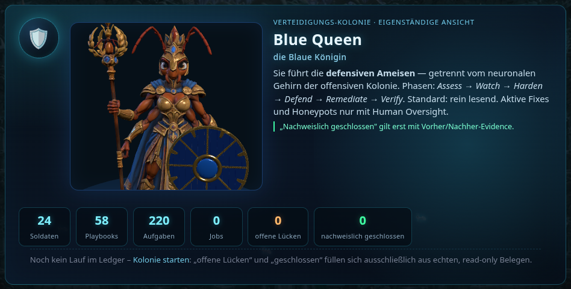

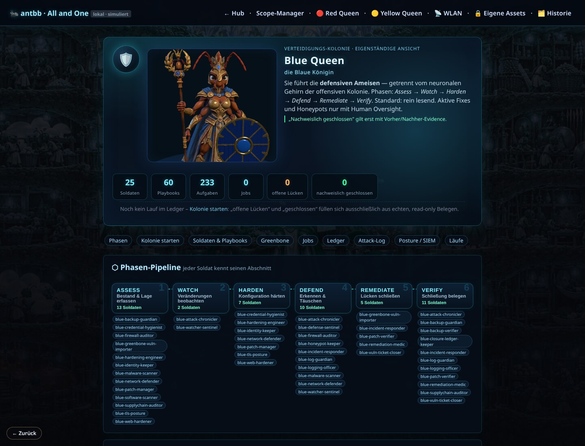

- **Phase pipeline:** Assess, Watch, Harden, Defend, Remediate, Verify.
- **Start the colony** (`POST /api/blue/run`): *Light* is Assess and Harden, *Intensive* is every phase. Read-only by default. Active fixes (`apply_fixes`) only with Oversight, otherwise HTTP 403.
- **Greenbone/OpenVAS:** report import (XML, CSV, JSON, read-only) and a scoped scan of one in-scope host. Oversight is required. Without GVM the answer is an honest HTTP 503.
- **Jobs:** repeatable checks (software scan, hardening, remediation verify) with an interval and a manual trigger.
- **Posture ledger:** before and after, across runs. "Shown closed" only with a re-check.
- **Attack log** (append-only), **posture/SIEM** (optional Splunk HEC), **remediation** (the fix bridge from Red; without target Oversight, HTTP 403), **Blue runs**.

## Yellow Queen – Reverse engineering

Route `/yellow`. 9 RE soldiers (triage, pe, dotnet, android, elf, hex, carve, dos, dynamic), Ghidra and ghidra-mcp.

> **Operating note:** The normal case pipeline is real (`file`, `strings`, `readelf`, `rizin`, live JSONL). Orchestrate steps read the case folder `CASES_DIR/<id>`, including `evidence/sample.bin` (they used to look, wrongly, in `DATA_DIR/cases`). `analyzeHeadless` is invoked when Ghidra is installed. If `capa` or `floss` is missing, the result stays honestly empty.

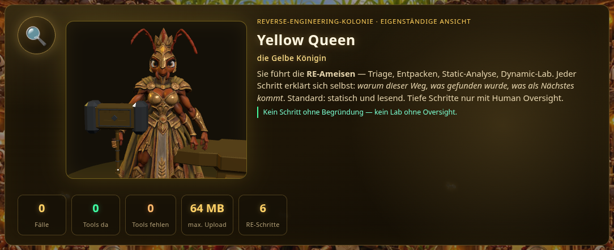

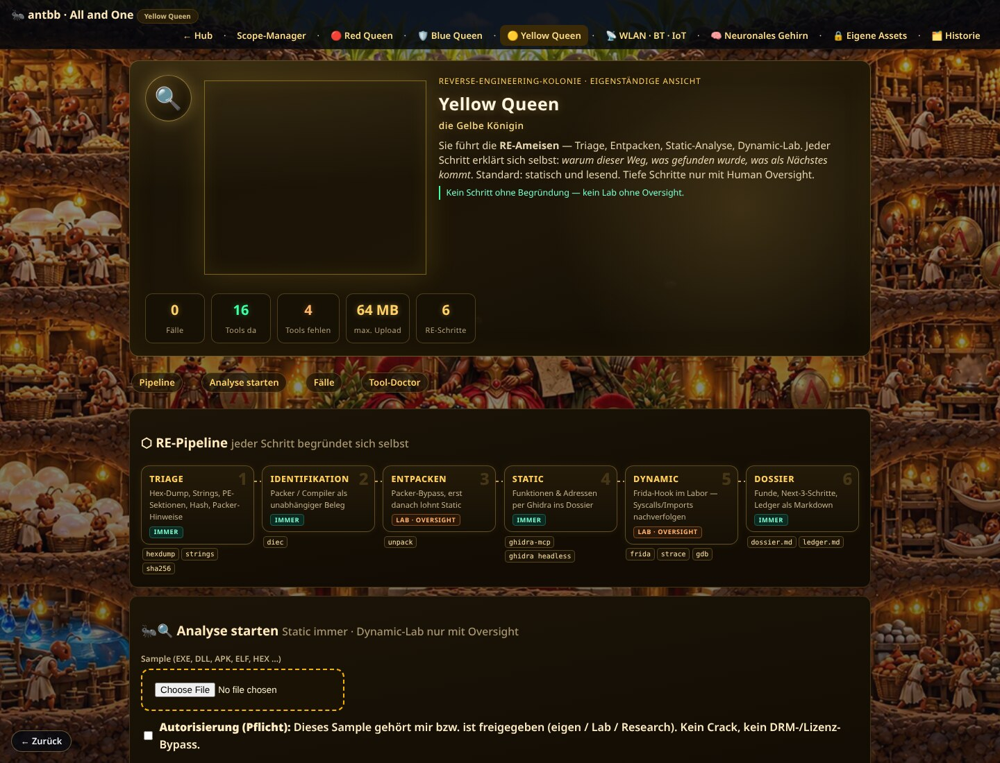

- **RE pipeline:** triage (hex, strings, sections), identification (diec), unpack (lab, Oversight), static (Ghidra), dynamic (Frida lab, Oversight), dossier.
- **Start an analysis:** sample upload (EXE, DLL, SYS, APK, SO, ELF, BIN, HEX, and more) only with a confirmed authorization. The dynamic lab only with Oversight.
- **Orchestration** (`yellow-queen/queen/orchestrator.py`): create the case only after the authorization gate passes, then classify, choose a toolchain, run the soldiers, and merge the results into the dossier, the ledger, and the neural brain. Every hop has a reason. The next three steps are derived from real findings.
- **Cases** (`/yellow/case/{id}`, `/yellow/laeufe`): hops, next-3, findings with an address, evidence links. Each case has `ledger.md` and `dossier.md` in the case folder.
- **Tool doctor:** tool status (Ghidra, diec, Frida, and others) with path and purpose.

## Shared areas

### Hub (`/`)

The front door: the three queen cards, live status from the colony, and the legal notice.

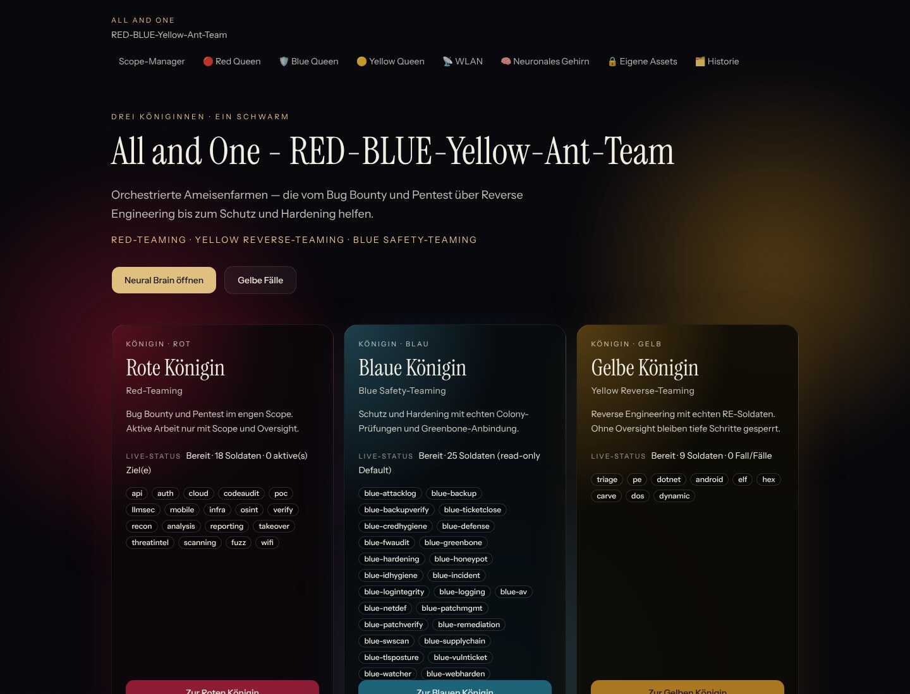

### Neural brain (`/brain`)

The neural brain stores what the platform knows and shows it as a 3D ant city: the Red Queen on the throne in the center, the Blue Queen in her watch quarter, the Yellow Queen in her forge. The nameplates follow the real 3D positions. The city can be turned. Red and blue soldier plates come live from `/api/soldiers`. The yellow ones come from the static `YELLOW` list in `antbb/web/static/brain/ants3d.js`. Without WebGL the view shows only a text notice. Beside that, a node panel with logs, a time-lapse, and the swarm wiki (who, what, how, where, why). Aliases: `/red/brain`, `/blue/brain`, `/yellow/brain`.

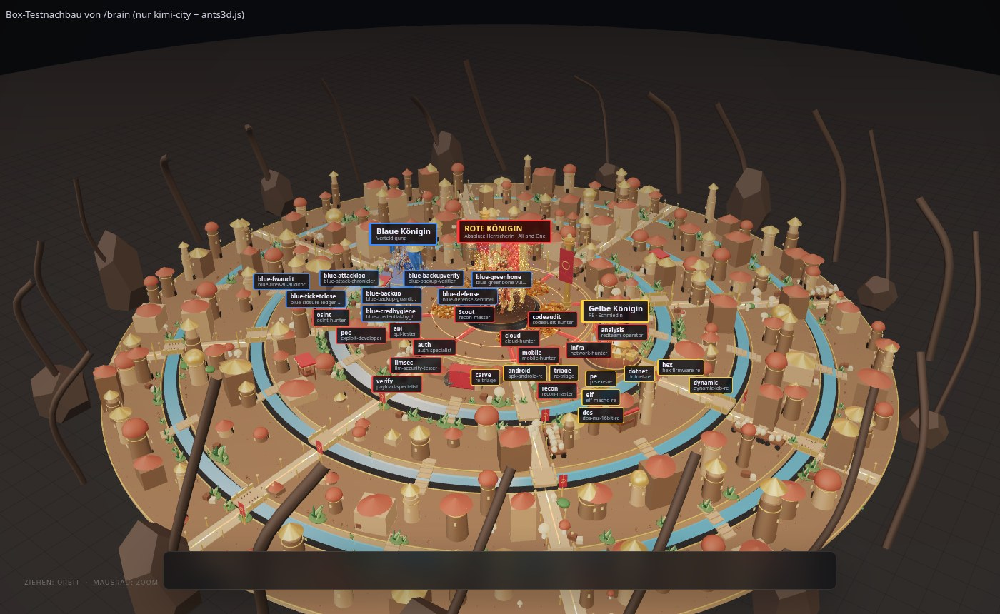


### History (`/history`)

Persistent run history for every team, with a time-lapse and an export index (`GET /api/exports`, download through `/exports/{name}` from `data/exports/`).

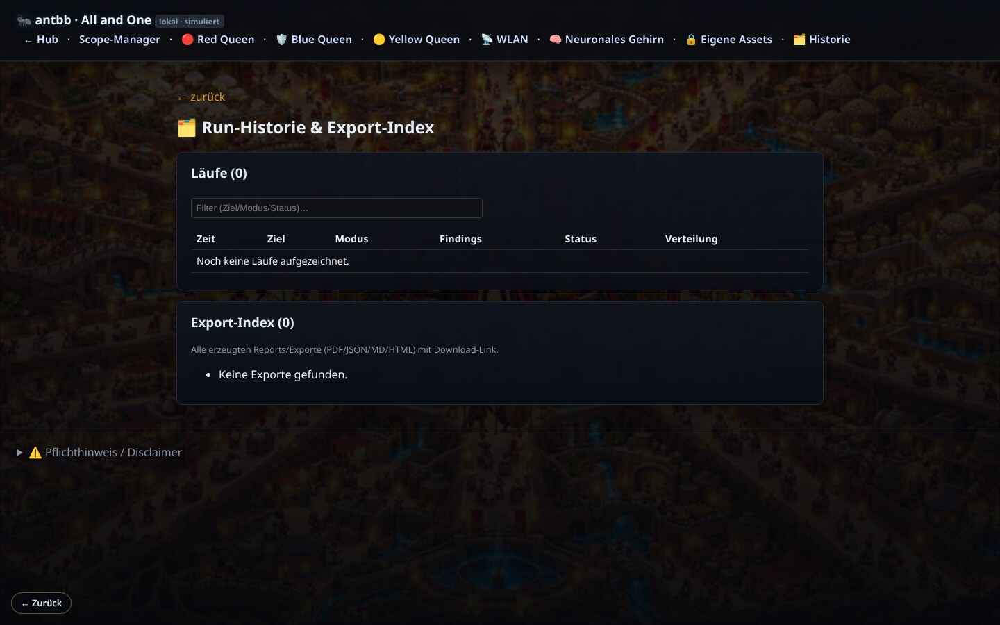

### Reports (all teams)

A fixed folder per queen under `data/reports/<red|blue|yellow>/` (gitignored, because the findings are real). Each run or case produces an HTML report and, with weasyprint or wkhtmltopdf, a PDF (`antbb/report_store.py`, using the existing report logic). The PDF dependencies are in [requirements-report.txt](requirements-report.txt).

| Team | Source | Create |
|---|---|---|
| Red | branded target report (`brandedreport`) | `POST /api/reports/generate` with `{"queen":"red","target_id":…}` |
| Blue | a run from history plus the target findings | `{"queen":"blue","run_id":…}` |
| Yellow | the case's `dossier.md` and `ledger.md` | `{"queen":"yellow","case_id":…}` |

Overview and the create form: `GET /reports`. The list as JSON: `GET /api/reports`. Download: `GET /reports/<queen>/<file>` (file names pass a whitelist, the path is checked with `resolve()`). In History every run has a PDF button.

### Other routes

| Route | What it is |
|---|---|
| `/target/{id}` | Target detail: scope, Oversight, mode, findings, reports, scan status |
| `/target/add` | Create a target |
| `/assets` | Your own assets (TLS and header checks) |
| `/trash` | Archived targets, restorable |

## Architecture

One process, one port (`:1001`), three apps inside it:

```text
antbb.service (python -m api, WorkingDirectory=/opt/antbb)
├── /                Hub          → Next.js static export (all-and-one/out)
├── /red /blue       Colony       → antbb.web (FastAPI)
├── /yellow …        Yellow Queen → yellow_queen.web (FastAPI, RE orchestration)
├── /brain           Neural brain → colony brain
├── /wlan /assets /history …     → colony routes
└── /api/…           Queen APIs, targets, runs, feed, capabilities, Blue jobs
```

- **One address, same origin:** every page and API is behind `http://127.0.0.1:1001`. No CORS, no sidecar required.
- **Real data only:** no mocks in the finished product. Every number comes from the registry, the store, or tool output.
- **Static files:** `/static` is merged from colony and Yellow static. The hub is served from `all-and-one/out`.

## Installation

The full first run (user `antbb`, hash, service, loopback) is the [Quick start](#quick-start). This section adds prerequisites, the model menu, the hub build, and the check. It does not describe a second, different way to start.

Prerequisites: **Linux** (tested on Debian/Ubuntu), **Python 3.11 or newer**, **Node.js 20 or newer** (only to build the hub), git. WLAN features need a WLAN card with monitor mode. Greenbone is optional.

### 1. Clone and environment

A local checkout without systemd. This is not a substitute for `/opt/antbb`:

```bash
git clone https://github.com/krockodog/antbb-framework.git
cd antbb-framework
python3 -m venv .venv
.venv/bin/pip install -r requirements.txt
```

### 2. Configuration

```bash
cp antbb.env.example antbb.env   # chmod 600, never commit
chmod 600 antbb.env
```

`antbb.env` is gitignored. The password hash in it is required before the process will start. Generate it from the checkout:

```bash
.venv/bin/python -m antbb.webauth hash-password
```

Put the printed line into `antbb.env` as `ANTBB_ADMIN_PASSWORD_HASH=`. The unit install is written out in [DEPLOY.md](DEPLOY.md).

The first `./run.sh` shows a model and access menu:

1. **Your own model (API key).** MiniMax (the one that is always offered), Claude, ChatGPT, Gemini, Qwen, Mistral. Edition Free.
2. **Ollama.** A local model, no cloud key. Edition Free.
3. **OAuth login.** Identification, then the Plan edition with the extended features.
4. **Enter.** Continue without a model. Edition Free.

Stored in `antbb.env`: `ANTBB_AI_MODE`, `ANTBB_EDITION=free|plan`, provider, and keys. How the menu behaves: [INSTALL.md](INSTALL.md).

Other optional variables, with safe defaults: `ANTBB_HOST`, `ANTBB_PORT`, `COLONY_DB`, `COLONY_DATA`, `YELLOW_QUEEN_ROOT`, `ANTBB_WIFI=1`, `GVM_USERNAME`, `GVM_PASSWORD`, `ANTBB_SPLUNK_HEC_URL`, `ANTBB_SPLUNK_HEC_TOKEN`, `MINIMAX_API_KEY` (runtime only).

### 3. Build the hub (Next.js static export)

```bash
cd all-and-one
npm ci
npm run build          # writes out/
rm -f out/*.txt        # do not serve the RSC payload files
cd ..
```

`all-and-one/out` is the web root for `/`. The unit sets `ALLONE_WEB_ROOT=/opt/antbb/all-and-one/out` for that.

### 4. Start

The service and the direct start are in the [Quick start](#quick-start): `systemctl enable --now antbb`, or `python -m api --host 127.0.0.1 --port 1001` as user `antbb`, with `antbb.env` sourced.

> **Password.** Without `ANTBB_ADMIN_PASSWORD_HASH` or `ANTBB_ADMIN_PASSWORD`, nothing starts. There is no default password.
>
> **Not root.** `User=antbb`. Starting as root is refused. `ANTBB_ALLOW_ROOT=1` only logs a warning and is not a supported setup.
>
> **Localhost.** The default is `ANTBB_EXPOSE=0`: the bind stays `127.0.0.1`. Network access is `ANTBB_EXPOSE=1` and prints a warning. Prefer an SSH tunnel. Do not publish the port.
>
> **Remote access.** An SSH tunnel (`ssh -L 1001:127.0.0.1:1001 <user>@<host>`), not a published port.

`./run.sh` remains the second launcher, on port 8000. It is not the same process as `antbb.service` on port 1001.

### 5. Verify

```bash
curl -s http://127.0.0.1:1001/api/health
# {"ok": true, "service": "all-and-one", "queen_ids": ["red","blue","yellow"]}
```

`GET /api/health` does not need a session. Everything else needs a login at http://127.0.0.1:1001/login. Then: hub, choose a queen, create a target, maintain the scope, Oversight, start the colony.

> **Installer.** [`install.sh`](install.sh) accepts `--doctor`, `--noninteractive`, `--install-tools`, and `--dry-run`. There is no `--full` switch. Extra pentest tools and wordlists are `ANTBB_FULL=1 bash install-and-start.sh`. Skip the prompts with `ANTBB_NONINTERACTIVE=1` or `ANTBB_ASK_KEY=0`.

## Operation

- **Start runs:** create a target in the scope manager, set scope entries, confirm Oversight, start the colony. Read-only by default. Active or offensive only with the checkbox.
- **Scan depth:** *Light* (recon, scan, report) or *Intensive* (every phase). The choice is stored on the start request and in the log.
- **Fix bridge:** a Red finding, "Repair in Blue", a real remediate job in `/blue`.
- **Backups:** before patches the platform writes `*.bak-<timestamp>`. Database backup before "delete everything" in the brain.
- **Logs:** `journalctl -u antbb -f`.
- **Bind and account:** the service from the Quick start listens on `127.0.0.1:1001` as user `antbb`. Day-to-day operation does not change that.

## Guardrails and safety model

1. **Default-deny scope.** Empty means no target and no run.
2. **Human Oversight.** Active steps (deauth, PoC, fixes, scans against targets, tunnels) need the checkbox set. The legal notice does not replace it.
3. **Proof gate.** "Verified" counts only with evidence. A finding without evidence stays a suspicion.
4. **Honest-empty.** What cannot be done is reported as that result. No invented status.
5. **No secrets and no PII** in findings or reports. Cracked passwords are masked and never stored.
6. **Defensive default.** Read-only checks run without switching the platform into an offensive mode.
7. **Non-destructive find-and-prove.** A finding is shown and proved. It is not used to damage the target.
8. **Law.** A notice of German Criminal Code § 202a–c and the CFAA is on every page. Authorized targets only, your own devices only, your own networks only.

## Roadmap

Still open:

- **Yellow:** The case-folder path is fixed (`CASES_DIR/<id>/evidence/sample.bin`). `analyzeHeadless` is invoked when the binary is present. On the reference host, `capa` and `floss` are still missing; the result then stays honestly empty.
- **Persistent honeypot** with storage in `attack_events`.
- **Tamper-evident audit log** (`/audit`).
- **Bring the Greenbone service up** (`gvmd`, `python-gvm`).
- **Watcher event source** (auditd) for the Blue Queen.
- **3D buildings per knowledge stage:** the stage is already calculated and shown. The matching buildings in the 3D city are still missing.
- **A shop-window demo with no backend:** a static preview of the interface with no server running.
- **Real Yellow soldier data:** the yellow nameplates in the neural brain still come from a static list in `ants3d.js`, not from the API.
- **MiniMax M-plan key:** support for the subscription key in addition to the pay-as-you-go key.
- **Blue remediation per finding:** a targeted fix and a re-test for one finding at a time.
- **Real executors on `/api/queens/{q}/runs`:** connect runs on this route to real execution.

## Credits

| People | Role |
|---|---|
| Judith Pilarski ([@krockodog](https://github.com/krockodog)) | Concept, architecture, Oversight, maintainer |
| Cursor ([@cursoragent](https://github.com/cursoragent)) | AI-assisted development |
| lordix | Commits from the local development environment |
| Red Queen (platform identity) | Commits on scan tools and the neural brain |
| Kimi Work | Commit "All and One: kompletter Stand 2026-10-25" |

The list comes from the authors in `git log`.

## License and notice

See [LICENSE](LICENSE). This framework is built for **authorized security tests, your own lab, and learning how defenses work**. Misuse against systems you do not own is a crime, and the scope gate is there to refuse it. Knowing the trick is how you learn to stop it.
